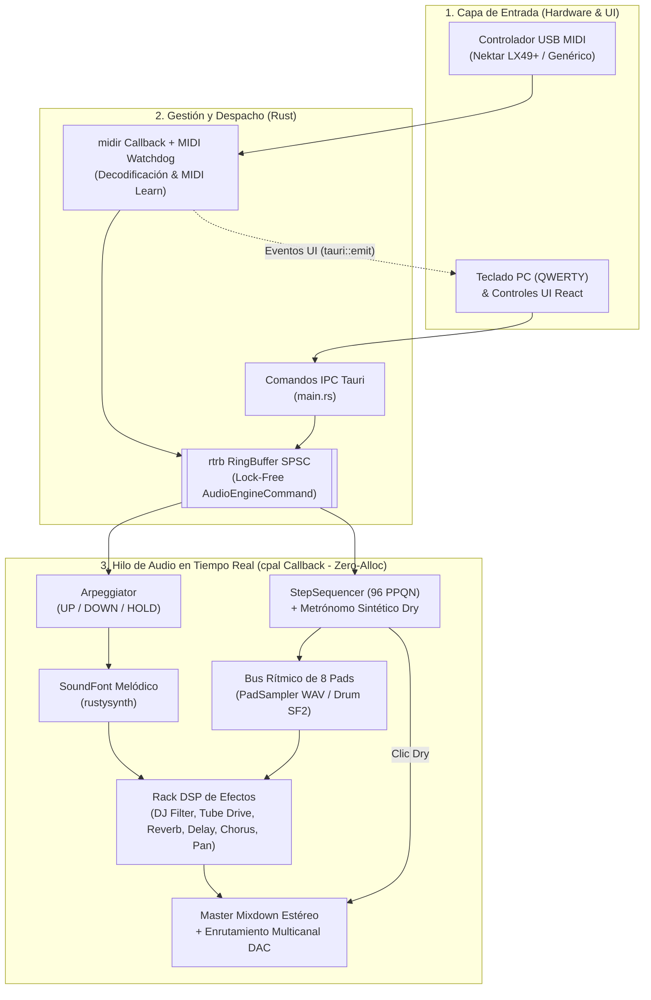

# ImpactSampler Studio — Especificación Técnica de Arquitectura (v1.0)

> Documento de referencia de ingeniería del sistema en su estado actual de producción multiplataforma (**Linux, Windows y macOS**).

---

## 1. Visión y Capacidades del Sistema

* **Objetivo del Sistema:** Estación de trabajo musical de escritorio de ultra-baja latencia basada en **Tauri v2 + Rust + React/TypeScript**. Procesa en tiempo real flujos MIDI de hardware y entradas de teclado de computadora (QWERTY) sobre un motor de síntesis híbrido (**SoundFont 2 `.sf2` + Sampler PCM `.wav`**), con secuenciador por pasos *sample-accurate*, arpegiador melódico y rack modular de efectos DSP.
* **Capacidades en Producción (v1.0):**
  * **Motor Melódico SoundFont 2 (`rustysynth`):** Síntesis polifónica estéreo de 32-bit float con soporte para bancos multi-preset, Pitch Bend continuo, Mod Wheel (`CC 1`), Sustain (`CC 64`), delimitación de rango acústico (ej. Mellotron G2–F5) y librería dual (*Factory Library* + *User Library*).
  * **Motor Rítmico de 8 Pads (`PadSampler` + `Drum SF2`):** Decodificación PCM `.wav` (16/24/32-bit vía `hound`) con *resampling* automático al sample rate nativo del DAC, modos *One-Shot* y *Gate* con micro-fadeout anti-click de 5 ms, y tres modos operativos (`WAV SAMPLER`, `DRUM SF2`, `MIRROR`).
  * **Secuenciador por Pasos Sample-Accurate (`StepSequencer`):** Reloj interno en el hilo de audio a **96 PPQN** (384 ticks por compás), resoluciones **1/8, 1/16 y 1/32** (hasta 32 pasos en 2 páginas), bancos independientes **A / B**, grabación *Overdub* cuantizada con anti-flam, calibración asistida de latencia de 8 golpes, *Paint / Erase Drag* continuo, pila de **Undo** LIFO de 16 estados y metrónomo sintético dry + overlay visual.
  * **Arpegiador Melódico (`Arpeggiator`):** Motor *sample-accurate* aislado del secuenciador (*Zero-Touch Sequencer*) con modos `UP`, `DOWN`, `UP/DOWN`, divisiones `1/4` a `1/32`, rango de 1 a 3 octavas y memoria `HOLD` (*latch*).
  * **Rack DSP de Efectos & Ruteo (`FxRack`):** Filtro Bipolar DJ TPT State Variable Filter (LPF/HPF 12 dB/oct con zona muerta central *bypass* y resonancia), *Warm Analog Tube Overdrive* asimétrico con *Auto-Gain Matching*, Reverb estéreo Schroeder-Moorer, Delay estéreo con filtro en feedback, Chorus en cuadratura y Panorámica de potencia constante, con ruteo selectivo (`KEYS | BOTH | PADS`).
  * **Conectividad Universal & Resiliencia Hot-Plug:** Perfil nativo precalibrado para **Nektar Impact LX49+**, sistema **MIDI Learn Universal** (faders, knobs, pads y 19 acciones de transporte/UI), entrada **QWERTY** e hilos guardianes (*Watchdogs*) para reconexión automática en caliente de interfaces de audio y puertos USB MIDI.

---

## 2. Stack Tecnológico y Garantías de Tiempo Real

* **Core / Runtime:** Rust (Edición 2021) + Tauri v2.
* **Subsistema de Audio (`cpal`):**
  * **Linux:** ALSA directo a hardware (`plughw:CARD=X,DEV=0`), PipeWire (`default`) y JACK, con silenciamiento FFI de `libasound` y nombres amigables vía `/proc/asound/cards`.
  * **Windows:** Soporte nativo dual **Steinberg ASIO** (`asio-sys` + panel de control nativo) y **WASAPI**.
  * **macOS:** **CoreAudio** nativo (Universal Binary `x86_64` + `aarch64`).
* **Subsistema MIDI (`midir`):** Captura asíncrona multiplataforma con filtrado automático de puertos secundarios duplicados (`MIDIIN2`).
* **Comunicación Inter-Hilo Lock-Free (`rtrb`):** Cola circular *Single-Producer Single-Consumer (SPSC)* de capacidad 512 para despacho de `AudioEngineCommand` hacia el hilo de audio en $O(1)$.
* **Frontend UI:** React 18 + TypeScript + Vite + Tailwind CSS + Lucide Icons + tipografías Geist Sans / Geist Mono (`tabular-nums`).
* **Garantías Estrictas del Hilo de Audio:**
  * **Zero-Alloc:** Cero asignaciones dinámicas de memoria en el callback de renderizado de `cpal` (buffers pre-reservados para síntesis, sampler, secuenciador, arpegiador y líneas de retardo DSP).
  * **Lock-Free:** Cero bloqueos (`Mutex` / `RwLock` / syscalls de E/S) dentro del bucle `render_internal`.

---

## 3. Arquitectura del Sistema y Flujo de Señal



---

## 4. Mapeo Físico de Hardware (Estándar Nektar Impact LX49+)

El sistema incluye de fábrica el mapeo completo para el **Nektar Impact LX49+**, pudiendo ser personalizado en cualquier momento mediante **MIDI Learn**:

| Sección Física | Controles | Identificador MIDI ( fábrica ) | Función Asignada en ImpactSampler Studio |
| :--- | :--- | :--- | :--- |
| **Teclado** | 49 Teclas + Ruedas | Notas `36`–`84` (C1–C5), Pitch Bend, `CC 1`, `CC 64` | Síntesis SoundFont melódica / Arpegiador / Modo Mirror |
| **Pads Rítmicos** | Pads 1 a 8 | Notas `36, 38, 42, 46, 39, 45, 50, 49` (y mapa GM/Cromático) | Disparo de slots 1–8 (`WAV Sampler` / `Drum SF2`) y grabación en Secuenciador |
| **Faders** | Faders F1 a F8 | `CC 38` a `CC 45` | Ganancia individual de los Pads 1 a 8 (`0.0` a `1.5x`) |
| **Fader Master** | Fader F9 | `CC 46` | Volumen Master global del sistema (`0%` a `100%`) |
| **Knobs** | Knobs K1 a K8 | `CC 56` a `CC 63` | K1: Cutoff Bipolar, K2: Resonance, K3: Tube Drive, K4: Reverb, K5: Delay Time, K6: Delay FB, K7: Delay Mix, K8: Pan *(reasignables)* |
| **Transporte** | Cycle, Rew, Fwd, Stop, Play, Rec | `CC 102` a `CC 107` | Tap Tempo (`102`), BPM `-1` (`103`), BPM `+1` (`104`), Stop (`105`), Play/Pause (`106`), Record Overdub (`107`) |
| **Botones B1–B9** | 9 Botones Físicos | `CC 47` a `CC 55` | B1: Clic Audio, B2: Grid 1/8, B3: Grid 1/16, B4: Grid 1/32, B5: Bank A/B, B7: Clear Track, B8: Metrónomo Visual, B9: Clear Pattern |

---

## 5. Estructura Real de Módulos del Proyecto

```text
ImpactSamplerStudio/
├── src-tauri/
│   ├── Cargo.toml
│   ├── tauri.conf.json
│   └── src/
│       ├── main.rs                 # Punto de entrada Tauri, comandos IPC, estado global y Watchdogs
│       ├── audio/
│       │   ├── mod.rs              # Definición de AudioEngineCommand y tipos de telemetría
│       │   ├── engine.rs           # Gestión de streams cpal (ALSA/ASIO/WASAPI/CoreAudio) y bucle de render
│       │   ├── sampler.rs          # Motor PCM de 8 pads (WAV loader, resampler lineal, One-Shot/Gate)
│       │   ├── sequencer.rs        # Secuenciador de 96 PPQN, cuantización, bancos A/B, Undo y metrónomo
│       │   ├── arpeggiator.rs      # Arpegiador melódico sample-accurate (UP, DOWN, UP/DOWN, HOLD)
│       │   └── fx.rs               # Rack DSP estéreo (SVF Bipolar Cutoff, Tube Drive, Reverb, Delay, Chorus)
│       ├── midi/
│       │   ├── mod.rs              # Enumeración de puertos midir, parser de paquetes y conexión activa
│       │   ├── mapping.rs          # Perfil de fábrica del Nektar Impact LX49+ y resolución de notas de pads
│       │   └── sniffer.rs          # Utilidad CLI de diagnóstico de mensajes MIDI en tiempo real
│       └── soundfont/
│           └── mod.rs              # Escáner de librerías (Factory + User) y resolución multi-tier de rutas
└── src/
    ├── App.tsx                     # Orquestador de estado global, listeners IPC, MIDI Learn y atmósfera
    ├── components/
    │   ├── Header.tsx              # Barra superior: telemetría de audio/MIDI, QWERTY toggle, MIDI Learn y Master
    │   ├── HardwareSkeleton.tsx    # Chasis monolítico: faders, knobs, display OLED, ruedas y teclado de 49 teclas
    │   ├── PerformanceBay.tsx      # Cápsulas Noir-Tech de enrutamiento FX (KEYS/PADS) y Arpegiador (ARP/HOLD)
    │   ├── StepSequencer.tsx       # Bahía rítmica de 8 tracks x 16 pasos, Paint/Erase Drag y barra de transporte
    │   ├── InstrumentSelectModal.tsx # Catálogo fotográfico de instrumentos de fábrica y librería de usuario
    │   ├── AudioSettingsModal.tsx  # Configuración de driver/dispositivo, buffer, sample rate, calibración y MIDI
    │   └── SplashScreen.tsx        # Presentación inicial atómica sin parpadeo de ventana
    ├── config/
    │   └── instrumentCatalog.ts    # Registro declarativo de instrumentos, paletas de color y rangos de teclas
    └── hooks/
        └── useQwertyKeyboard.ts    # Mapeo musical agnóstico de teclado físico (event.code) con anti-notas colgadas
```

---

## 6. Subsistema de Recursos y Persistencia

1. **Resolución Multi-Tier de Activos (`soundfonts/` y `samples/`):**
   * **Tier 1 (Bundle Instalado):** Ruta oficial de recursos provista por Tauri (`app.path().resource_dir()`) y rutas estándar de paquetes Linux (`/usr/lib/ImpactSampler Studio/` o puntos de montaje AppImage `/tmp/.mount_*/usr/lib/`).
   * **Tier 2 (Ejecutable Portable):** Directorio adyacente al binario ejecutable (`current_exe().parent()`).
   * **Tier 3 (Desarrollo Local):** Rutas relativas del árbol de código (`./soundfonts`, `../soundfonts`, `./samples`, `../samples`).
2. **Persistencia de Configuración:**
   * **Preferencias de Motor de Audio (`audio_preferences.json`):** Almacenadas nativamente en `$HOME/.config/ImpactSamplerStudio/` (Linux/macOS) o `%APPDATA%\ImpactSamplerStudio\` (Windows), preservando host, dispositivo, canales de salida, frecuencia de muestreo y tamaño de buffer entre sesiones.
   * **Preferencias de Interfaz y Mapeos (`localStorage`):** Persistencia automática de asignaciones de **MIDI Learn** (`impact_sampler_midi_learn_v1`), compensación de latencia por dispositivo de audio y ruta de la **User Library** de SoundFonts.
