# Plan de Trabajo - ImpactSampler Studio

> Hoja de ruta para el desarrollo de la aplicación de escritorio de baja latencia con **Tauri v2 + Rust + React/TypeScript** para el controlador **Nektar Impact LX49+**.

---

## 1. Estrategia de Verificación y Hardware (Fase 1)

### ¿Debe estar conectado el controlador en la Fase 1?
* **Sí, es altamente recomendable.** Tener el cable USB conectado nos permitirá validar de forma inmediata que Windows expone el puerto MIDI, que `midir` se enlaza correctamente y que los paquetes de datos físicos (teclas, pads, faders) llegan sin pérdidas ni jitter.
* *(Nota: El código incluirá un modo de simulación/mock para desarrollo en caso de no tener el hardware conectado en algún momento).*

### ¿Habrá UI o será por consola?
* Implementaremos un **enfoque híbrido en dos pasos**:
  1. **Sniffer CLI (Consola):** Un ejecutable/modo rápido en Rust (`cargo run --bin sniffer`) que en cuestión de segundos enumerará los puertos MIDI de Windows y mostrará en consola en tiempo real los mensajes capturados al presionar teclas, golpear pads o mover faders. Esto valida la capa de hardware y drivers sin interferencia del frontend.
  2. **UI Base (Tauri v2):** La ventana de la aplicación mostrará un panel inicial con el selector de dispositivo MIDI, selector de salida de audio WASAPI y un monitor visual en tiempo real de eventos recibidos.

---

## 2. Fases de Desarrollo

```mermaid
flowchart TD
    F1["Fase 1: Cimientos (MIDI + Audio Base + Lock-Free)"] --> F2["Fase 2: Bus Teclado (SoundFont .sf2 + Pitch/Mod)"]
    F2 --> F3["Fase 3: Bus Pads (Sampler One-Shot & Gate/Retrigger)"]
    F3 --> F4["Fase 4: Controles Físicos (Knobs Melódicos + Faders Rítmicos)"]
    F4 --> F5["Fase 5: Secuenciador Rítmico de Pads (Clock Sample-Accurate)"]
    F5 --> F53["Fase 5.3: Microajustes de Ergonomía & Síntesis de UX/UI"]
    F53 --> F6["Fase 6: Infraestructura de Distribución, Empaque (.exe) & Librería Extensible"]
    F6 --> F7["Fase 7: Teclado de Computadora (Entrada QWERTY)"]
    F7 --> F8["Fase 8: Personalización del Instalador Tradicional & Branding Visual"]
    F8 --> F9["Fase 9: Motor de Arpegiador Melódico Integrado"]
    F9 --> F91["Fase 9.1: Cápsulas Noir-Tech & DSP Avanzado (DJ Filter & Tube Drive)"]
    F91 --> F92["Fase 9.2: Preparación Multiplataforma & Empaque Universal (macOS .dmg & Windows .exe)"]
    F92 --> F10["Fase 10: Wizard Interactivo de Calibración & Perfiles Hardware Universal"]
    F10 --> F11["Fase 11: Sistema de Sesiones (.impact), Gestión de Proyectos & Exportación"]
    F11 --> F12["Fase 12: Drum Kit Creator (WAV Pool a SF2 Compiler)"]
    F12 --> F13["Fase 13: Sistema de Auto-Actualizaciones OTA (Tauri Updater)"]
    F13 --> F14["Fase 14: Estrategia Multi-Plataforma (Mobile, Web App & VST3/CLAP)"]
```

---

---

### Fase 1: Cimientos del Sistema (MIDI, Audio Engine & Core Lock-Free) ✅ [COMPLETADA]

* **Objetivo:** Establecer la infraestructura de comunicación de baja latencia entre el hardware, el motor de audio y la UI.
* **Entregables Logrados:**
  * Estructura base Tauri v2 (Rust + React/Tailwind/Vite).
  * Detección y filtrado de puertos del Nektar Impact LX49+ (aislamiento del puerto primario para evitar duplicación de notas con `MIDIIN2`).
  * Mapeo verificado de hardware: 49 teclas (C1-C5), 8 Pads MPC (P1-P4 abajo, P5-P8 arriba), 9 Faders (CC 38-46), 8 Knobs (CC 56-63), Pitch Bend y Mod Wheel.
  * Motor de audio WASAPI multi-formato (`F32`, `I16`, `U16`) con canal lock-free `rtrb` SPSC.
  * Oscilador armónico aditivo enriquecido (fundamental + armónicos) audible al 100% en altavoces de PC y auriculares.
  * Interfaz interactiva completa: teclas con glissando, pads clickeables, faders y knobs arrastrables, pitch bend con resorte automático a 0.
  * Ventana maximizada por defecto y monitor MIDI en tiempo real.

---

### Fase 2: Bus Melódico del Teclado (Motor SoundFont .sf2 & Watchdog Hot-Plug) ✅ [COMPLETADA]

* **Objetivo:** Dotar a las 49 teclas del Nektar Impact LX49+ de sonido polifónico de alta fidelidad basado en muestras reales `.sf2`, integrando una experiencia de usuario (UX/UI) minimalista y blindaje de audio ante desconexiones.
* **Entregables Logrados:**
  * **Pantalla de Inicio / Selector Minimalista:**
    * Tarjetas sobrias para los 3 instrumentos en `soundfonts/`:
      1. 🎹 **Grand Piano** (`Piano - Realtime.sf2` • 126 MB • Steinway Samples)
      2. ⚡ **Rhodes Mark I** (`Rhodes (from Dream Piano).sf2` • 522 MB • 70s Vintage Electro-Mechanic)
      3. 📼 **Mellotron Tape** (`Mellotron.sf2` • 116 MB • 12 Vintage Presets)
    * Barra de carga ultrafina con reporte de progreso no bloqueante.
    * Botón en `Header` para hot-switching de instrumento en caliente durante la sesión.
    * Selector de parches/presets dinámico en el `Header` para bancos multi-instrumento (como los 12 timbres del Mellotron).
  * **Delimitación de Rango Físico del Mellotron:**
    * Teclado virtual adaptado al rango útil de 35 notas de cinta (**Notas 43 a 77: G2 a F5**).
    * Teclas fuera de rango atenuadas con sombra noir y desactivadas para emular la mecánica real de cinta.
  * **Motor de Render SoundFont 2 (Backend Rust con `rustysynth` v1.3.7):**
    * Síntesis estéreo de 32-bit float en el hilo de audio con buffers pre-alocados zero-alloc.
    * Note On con curvas de velocidad dinámicas, Note Off, Pitch Bend continuo, Mod Wheel (CC 1) y Sustain Pedal (CC 64).
  * **Watchdog de Auto-Recuperación de Audio (Hot-Plug & Reconnect):**
    * Hilo guardián en background que detecta invalidación de endpoint WASAPI (`AUDCLNT_E_DEVICE_INVALIDATED`).
    * Reconstrucción automática del stream en cuanto Windows restaura el dispositivo sin requerir reiniciar la app.
    * Preservación atómica de estado: preserva el SoundFont cargado en RAM, el preset activo y el volumen master.
    * Indicador visual dinámico en el `Header` (verde esmeralda activo / ámbar buscando salida).

---

### Fase 3: Bus Rítmico de Pads (Sampler PCM: One-Shot & Gate/Retrigger & Drum Kit SF2) ✅ [COMPLETADA]

* **Objetivo:** Implementar los 8 slots de samples para percusión y efectos sonoros asociados a los pads físicos con soporte multi-motor.
* **Entregables Logrados:**
  * **Motor Sampler PCM Zero-Alloc en Rust (`src-tauri/src/audio/sampler.rs`):**
    * Decodificación de archivos `.wav` (16-bit, 24-bit, 32-bit float) con `hound`.
    * Resampling lineal offline automático al sample rate nativo del stream activo de WASAPI.
    * 8 slots de memoria continua con buffer estéreo y mezcla de baja latencia sin alocaciones en el hilo de audio.
    * Lógica de reproducción por voz dual:
      * **One-Shot:** Reproducción completa del sample ignorando Note-Off con retrigger instantáneo libre de clicks.
      * **Gate:** Suena mientras el pad se mantiene presionado y corta con micro-fadeout suave de 5 ms al soltar.
  * **Arquitectura de Tres Modos Rítmicos:**
    1. **WAV SAMPLER:** Cada pad reproduce su archivo `.wav` independiente con modo configurable.
    2. **DRUM SF2:** Reproducción de batería SoundFont independiente (`Yamaha_RX7_Drums.sf2`) mapeando los 8 pads a Kick, Snare, Closed HH, Open HH, Clap, Low Tom, High Tom y Crash sin interrumpir el piano melódico en las teclas.
    3. **MIRROR:** Los pads duplican las notas del teclado para tocar el SoundFont cromático.
  * **Kit de Fábrica Precargado (`samples/`):**
    * 8 muestras acústicas y electrónicas de alta fidelidad generadas y cargadas en RAM por defecto (Kick, Snare, Clap, Closed Hat, Open Hat, Low Tom, High Tom, Perc).
  * **UI Minimalista Noir-Tech y Ergonomía UX:**
    * Selector de modos tipográfico sobrio (`WAV SAMPLER  |  DRUM SF2  |  MIRROR`) en la cabecera superior sin emojis ni pills abultadas.
    * Pads limpios sin etiquetas redundantes "P1".."P8", mostrando el nombre del sample y modo de reproducción.
    * Iluminación perimetral idéntica al hardware Nektar Impact LX49+: borde verde esmeralda translúcido en reposo (`border-emerald-500/30`) y conmutación instantánea a rojo brillante reactivo (`border-red-500`) al ser golpeado.
    * Menú contextual mediante **clic derecho** sobre cualquier pad: Cargar sample WAV nativo (`rfd`), alternar One-Shot/Gate y vaciar slot.
    * Soporte para **Drag & Drop** de archivos `.wav` con highlight perimetral cian reactivo.
    * Persistencia de los 8 slots de samples a través del watchdog de audio WASAPI ante desconexiones de hardware.

---

### Fase 4: Modulación, FX Rack Modular y Ruteo de Mezcla ✅ [COMPLETADA]

* **Objetivo:** Implementar la matriz física completa para procesar en vivo el instrumento del teclado y los pads con DSP de alta fidelidad, asignaciones dinámicas y ruteo selectivo.
* **Entregables Logrados:**
  * **Rack de Efectos Estéreo Zero-Alloc en Rust (`src-tauri/src/audio/fx.rs`):**
    * **Filtro Paso Bajo:** Topología virtual analógica estilo Moog Ladder de 4 polos (24 dB/oct) con resonancia autolimitada (Cutoff 40 Hz - 18 kHz).
    * **Warm Drive:** Saturación analógica cálida no lineal con función `tanh` suave.
    * **Reverb Estéreo:** Motor Schroeder-Moorer (Freeverb) con 8 filtros peine (*comb*) y 4 filtros paso-todo (*all-pass*) con difusión estéreo.
    * **Delay Estéreo con Feedback:** Delay de buffer circular modulable con filtro paso-bajo en el lazo de realimentación (40 ms a 1 s).
    * **Chorus Estéreo:** Modulación LFO sinusoidal en cuadratura (90° fase estéreo) con doble línea de retardo interpolada.
    * **Panorámica Estéreo:** Panning continuo con ley de paneo sinusoidal de potencia constante (-3 dB en el centro).
  * **Knobs K1 - K8 Reasignables Dinámicamente:**
    * Mapeo físico verificado con el Nektar Impact LX49+ (CC 56 a 63).
    * Configuración de fábrica optimizada: K1: Cutoff, K2: Resonancia, K3: Drive, K4: Reverb Mix, K5: Delay Time, K6: Delay Feedback, K7: Delay Mix, K8: Paneo.
    * Menú contextual mediante **clic derecho** sobre cualquier knob en la UI para reasignarlo instantáneamente a cualquiera de los 9 parámetros del rack de efectos.
  * **Faders F1 - F9 de Mezcla en Tiempo Real:**
    * F1 a F8 controlan la ganancia individual de cada uno de los 8 slots de pads (0 a 1.5x) con respuesta lineal y suave.
    * F9 controla el volumen Master global del sistema (0 a 100%).
  * **Selector de Ruteo FX de 3 Pasos (`KEYS | BOTH | PADS`):**
    * Selector minimalista integrado en la cabecera de los knobs.
    * `KEYS`: Los efectos procesan únicamente el sintetizador melódico; los pads pasan en seco (*dry*).
    * `BOTH`: Suma estéreo master completa a través del rack de efectos.
    * `PADS`: Los efectos procesan exclusivamente el bus rítmico de percusión/sampler.
    * Ejecución lock-free mediante buffers dedicados en el motor de audio sin alocaciones dinámicas ni pausas.
* **Criterio de Aceptación:**
  * Manipular los knobs K1-K8 y faders F1-F9 modula el sonido en tiempo real con 0 latencia perceptible y respuesta fluida.
  * El cambio de ruteo y reasignación de knobs opera sin cortes, clicks ni degradación del rendimiento.

---

### Fase 5: Secuenciador Rítmico de Pads (Step Sequencer en Tiempo Real) ✅ [COMPLETADA]

* **Objetivo:** Permitir que los 8 pads ejecuten loops y patrones rítmicos sincronizados mientras se toca libremente el teclado con el SoundFont melódico, controlado directamente desde los botones de transporte físico y los 9 botones asignables (B1..B9) del Nektar Impact LX49+.
* **Entregables Logrados:**
  * **Reloj Zero-Jitter Sample-Accurate en Rust (`src-tauri/src/audio/sequencer.rs`):**
    * Reloj de alta precisión integrado directamente en `render_internal` contando muestras a 48,000 Hz ($0\%$ CPU adicional, $0$ alocaciones en hilo de audio).
    * Disparo inmediato en **frame cero exacto** al dar Play (**0 ms de latencia inicial**).
    * Patrón rítmico expandido a **16 pasos** y 8 pistas correspondientes a los 8 pads (Kick a Ride / WAV Sampler).
    * **Grilla inicial 100% limpia** al iniciar la aplicación (sin patrones precargados).
    * **Selector de resolución de rejilla (*Grid*):**
      * **Modo 1/8 (Corcheas):** 16 pasos = 2 compases completos de 4/4 (8 tiempos de negra).
      * **Modo 1/16 (Semicorcheas):** 16 pasos = 1 compás completo de 4/4.
      * **Modo 1/32 (Fusas):** 16 pasos = 2 tiempos de negra (medio compás), ideal para *hi-hat trap rolls* ultraprecisos.
    * Rango de tempo dinámico de 40 a 300 BPM con algoritmo de Tap Tempo suave.
  * **Metrónomo Sonoro Clic Dry Sintético (Audio Click Track):**
    * Generador de impulsos senoidales analógicos con decaimiento percusivo exponencial de ~18 ms sintetizado directamente en el callback de audio.
    * Frecuencias calibradas: **1600 Hz** en el primer pulso del compás (*downbeat*) y **850 Hz** en los pulsos secundarios de negra.
    * Enrutado limpio (*dry*) directamente a la salida estéreo sin pasar por los efectos de reverberación o delay, garantizando máxima inteligibilidad rítmica.
  * **Sistema de Doble Banco de Patrones (Pattern Bank A / B):**
    * Almacenamiento independiente en RAM para el Banco A y el Banco B.
    * **Clonación Inteligente:** Al alternar por primera vez al Banco B, clona automáticamente el ritmo del Banco A para permitir crear variaciones o cortes inmediatos sin empezar de cero.
  * **Integración Hardware Completa con el Nektar Impact LX49+ (15 Controles Físicos):**
    * **Botones de Transporte (CC 102 a 107):**
      * `CC 102 (Cycle)`: Tap Tempo.
      * `CC 103 (Rewind)`: Disminuir tempo en 1 BPM.
      * `CC 104 (Forward)`: Aumentar tempo en 1 BPM.
      * `CC 105 (Stop)`: Detener reproducción y rebobinar al paso 1.
      * `CC 106 (Play)`: Iniciar / Pausar secuencia (o barra espaciadora en teclado de computadora).
      * `CC 107 (Record)`: Grabación Overdub en tiempo real con **cuantización al 50% hacia el paso más cercano** y **Full Level 127** unificado (misma pegada máxima tanto al tocar en vivo como en la reproducción grabada).
    * **9 Botones Asignables Físicos B1..B9 (CC 47 a 55):**
      * `B1 (CC 47)`: **Audio Clic ON/OFF** (activa/desactiva el metrónomo sonoro).
      * `B2 (CC 48)`: **Grid 1/8** (resolución de corcheas - 2 compases).
      * `B3 (CC 49)`: **Grid 1/16** (resolución de semicorcheas - 1 compás).
      * `B4 (CC 50)`: **Grid 1/32** (resolución de fusas - 2 tiempos).
      * `B5 (CC 51)`: **Pattern Bank A / B** (alterna entre banco A y B).
      * B6 (CC 52): **Sin función / Reservado** (desactivado hasta Paso 4.1).
      * `B7 (CC 53)`: **Clear Selected Track** (borra únicamente la pista del pad actualmente seleccionado).
      * `B8 (CC 54)`: **Toggle Visual Metronome** (muestra u oculta el overlay numérico gigante).
      * `B9 (CC 55)`: **Clear All Pattern** (limpia por completo el patrón de 16 pasos del banco activo).
  * **Metrónomo Visual Radical (Giant Overlay Full-Screen):**
    * Overlay minimalista proyectado a pantalla completa marcando los pulsos principales de negra ($1 \dots 8$ en 1/8, $1 \dots 4$ en 1/16, o $1 \dots 2$ en 1/32) con destello en el downbeat.
    * Sincronizado estrictamente al motor Rust y conmutable mediante botón UI o botón físico B8 (`CC 54`).
  * **Cuadrícula Rítmica Noir-Tech (`src/components/StepSequencer.tsx`):**
    * 8 filas de pads con nombres de instrumentos, botón de audición rápida y selección interactiva de pista activa (halo esmeralda neón).
    * Badges interactivos para Banco A/B (Cian / Púrpura), botón de Clic con LED sonoro ámbar y botón de Overlay.
    * Selector visual de resoluciones `GRID: [ 1/8 | 1/16 | 1/32 ]`.
    * Botón `CLR P{n}` para borrado rápido de la pista activa y botón general de borrado.
* **Criterio de Aceptación:**
  * Reproducción estable y sin deriva temporal a cualquier tempo.
  * Tocar pads en vivo o disparar melodías en el teclado mientras el secuenciador corre con clic funciona con 0 latencia y total solidez.

---

### Fase 5.1: Unificación Monolítica de Hardware & Ergonomía Noir-Tech (Completada ✅)
* **Objetivo:** Integrar el secuenciador rítmico y el controlador superior dentro de un único chasis de hardware continuo con ergonomía de vista única (cero scroll vertical).
* **Entregables y Mejoras Implementadas:**
  1. **Consola Monolítica Unificada:**
     - `HardwareSkeleton.tsx` ahora aloja a `StepSequencer.tsx` como componente acoplado directamente en el chasis físico, compartiendo la misma estructura de carcasa analógica.
     - `workstationMode` (`"keys"` vs `"seq"`): oculta el teclado de 49 teclas al entrar en modo secuenciador para concentrar toda la atención en la bahía rítmica sin duplicidad visual.
  2. **Pads de Silicona y Botones TR Mecánicos:**
     - 8 pads de silicona con bajo relieve, biselado táctil y underglow orgánico diferenciado por rol cromático (Kick, Snare, HiHats, Toms, Platillos).
     - 16 botones mecánicos TR con alternancia tonal clásica Roland (grafito y titanio), pips de acento en Downbeats (1, 5, 9, 13) y lentes LED internas centradas de alta respuesta visual.
  3. **Corrección de Estabilidad del Teclado:**
     - Eliminado el salto vertical/desplazamiento del riel de teclas al pulsar cualquier nota (`overflow-y-hidden` y anclaje físico de base).
  4. **Optimización de Espacio Vertical (Ajuste Zero-Scroll):**
     - Remoción de la regla superior de compases y de la fila numérica 1..16 para ganar ~60px verticales. Los 8 tracks arrancan de inmediato con lectura directa.
     - Calibración de altura por pista a `h-9 / h-9.5` (36px) con `gap-1.5`. Todo el instrumento (cabecera con faders/knobs + drum machine + barra de docking) queda 100% visible en una sola pantalla.
  5. **Barra de Docking Inferior Reorganizada:**
     - Selectores de modo minimalistas tipo serigrafía retro: `KEYS` y `SEQ`.
     - Selector de Kit reubicado en la barra con LED de estado y dropdown emergente hacia arriba (`Yamaha RX7` / `Custom WAV`).
     - Selector de banco compacto: `BANK A` / `BANK B`.
     - Selector de grid cíclico: `GRID 1/16 ▾` (1/8, 1/16, 1/32).

---

### Fase 5.2: Refinamientos de Diseño, MIDI Learn & Blindaje de Hardware ✅ [COMPLETADA]
* **Objetivo:** Perfeccionamiento estético y atmosférico de la consola, integración de nuevos instrumentos de estudio, implementación del sistema universal de MIDI Learn sin contaminación visual y blindaje total de la conexión MIDI ante desconexiones físicas en caliente (Hot-Plug).
* **Entregables y Mejoras Implementadas:**
  1. **Centrado Ergonómico de Consola ("Floating Masterpiece"):**
     - Eliminación de áreas muertas en modo `KEYS`.
     - Contenedor principal (`<main>`) centrado vertical y horizontalmente (`justify-center items-center my-auto`), otorgando presencia de consola de hardware flotante.
  2. **Atmósfera Noir-Tech Multicapa (Fondo de Estudio):**
     - **Canvas Base:** Negro puro `#050507` / `#070709` de máximo contraste.
     - **Iluminación Cenital (*Studio Overhead Spotlight*):** Gradiente radial blanco sutil en el borde superior emulando iluminación real de sala de control.
     - **Micro-Malla Acústica (*Precision Dot Matrix*):** Patrón de micro-perforaciones acústicas de 1.2px espaciadas a 28px con máscara elíptica de alta definición.
     - **Aura Reactiva Dinámica al Instrumento Activo:** Resplandor ambiental de fondo que cambia de color según el timbre seleccionado:
       * 🎹 *Grand Piano:* Ámbar dorado cálido (`rgba(245, 158, 11, 0.20)`).
       * ⚡ *Rhodes Mark I:* Cian electro-mecánico (`rgba(6, 182, 212, 0.20)`).
       * 📼 *Mellotron M400:* Rosa vintage cinta magnética (`rgba(244, 63, 94, 0.20)`).
       * 🥁 *Yamaha RX7:* Púrpura neón digital (`rgba(168, 85, 247, 0.22)`).
     - **Viñeta Perimetral Profunda:** Enmarcado óptico que enfoca la atención del usuario en el hardware central.
  3. **Splash Screen Inicial Cinematográfico & Presentación Atómica:**
     - Pantalla de bienvenida en negro puro con el logotipo `IMPACT SAMPLER` en tipografía de alta fidelidad y acento esmeralda neón.
     - Temporizado cinematográfico de 3 segundos con transición fade-out fluida (`opacity-0 scale-110 blur-sm`) de 700 ms hacia la consola.
     - **Solución definitiva al destello/flicker gris de WebView2:** La ventana de Tauri se configura para iniciar invisible (`visible: false` en `tauri.conf.json`) y se revela atómicamente mediante el comando nativo `show_main_window` una vez que el DOM negro del splash está 100% montado y renderizado, garantizando un arranque impecable y profesional.
  4. **Catálogo Fotográfico PNG en el Selector Modal de Instrumentos (`InstrumentSelectModal.tsx`):**
     - Integración de renders fotográficos de estudio en alta resolución con fondo transparente para cada instrumento:
       * 🎹 **Grand Piano:** Fotografía de piano de cola acústico de concierto (`piano.png`).
       * ⚡ **Rhodes Mark I:** Fotografía de piano electro-mecánico vintage de los años 70 (`rhodes.png`).
       * 📼 **Mellotron M400:** Fotografía de reproductor de cintas analógicas de culto (`melotron.png`).
       * 🥁 **Yamaha RX7:** Fotografía de la mítica caja de ritmos digital PCM de 1987 (`yamaharx7.png`).
     - Tarjetas interactivas con iluminación perimetral, escala suave al pasar el cursor (*hover micro-interaction*) y halo luminoso dinámico según el instrumento.
     - **Comportamiento inteligente de flujo:** Al seleccionar el Yamaha RX7, la consola conmuta automáticamente al modo Secuenciador (`SEQ`), permitiendo empezar a programar ritmos de inmediato sin clics adicionales.
  5. **Display OLED Hardware de Instrumentos & Presets (`HardwareSkeleton.tsx`):**
     - Pantalla empotrada en el chasis superior sobre la matriz de 8 Knobs con marco sobrio de hardware oscuro (`border-white/10`).
     - Muestra el instrumento activo (`INST: YAMAHA GRAND PIANO`, `MELLOTRON M400`, etc.) con LED esmeralda neón y acceso directo al catálogo de SoundFonts.
     - Selector de parches analógico (`PATCH: 001 - FLUTE`) con LED ámbar para bancos multi-instrumento.
  6. **Depuración Serigráfica y Controles Táctiles:**
     - Eliminación de etiquetas redundantes y ampliación del área vertical de faders a `h-28` (112px).
     - Reseteo a valores nominales por **doble clic** en faders y knobs (ganancia unitaria, paneo central y volumen al 80%).
     - Fader Master 9 con borde e iluminación cian dedicada.
     - Tipografía de alta gama Geist Sans y Geist Mono con cifras tabulares (`tabular-nums`) para 0 jitter horizontal.
  7. **Sistema Universal de MIDI Learn Minimalista:**
     - **Botón `MIDI LEARN` en el Header:** Botón limpio que al activarse resplandece en ámbar dorado con LED pulsante, sin banners invasivos ni desplazamiento de elementos.
     - **Faders 1–8 y Master Fader 9:** Resplandor de contorno ámbar en reposo (`border-amber-500/50`) y halo pulsante brillante (`border-2 border-amber-400 animate-pulse`) al seleccionarse para escucha de CC, manteniendo los números de valor limpios sin etiquetas `CC ..` sobrecargadas.
     - **Knobs 1–8:** Halo perimetral ámbar reactivo que pulsa al esperar movimiento de perilla física en cualquier controlador.
     - **Pads 1–8 en Secuenciador Rítmico:** Los slots de las pistas adquieren contorno ámbar elegante; al hacer clic, pulsan esperando la nota/pad del hardware externo sin tapar los nombres de las muestras.
     - **Sincronización Lock-Free en Rust:** Asignaciones de CC transferidas directamente al hilo de audio (`set_midi_learn_mappings`) a 0% CPU.
     - **Persistencia en `localStorage` & Restablecimiento de Fábrica:** Mapeos guardados automáticamente en el navegador y opción «Restablecer de Fábrica» ubicada de manera ordenada en el modal de Configuración (`AudioSettingsModal.tsx`), devolviendo instantáneamente el sistema a los estándares del Nektar LX49+.
  8. **Blindaje de Hardware en Caliente (MIDI Hot-Plug Watchdog):**
     - **Hilo Guardián `midi-watchdog` (0.00% CPU):** Hilo en segundo plano en Rust suspendido con `std::thread::sleep(1200ms)`. Al despertar, realiza una lectura ultra-rápida de 20 nanosegundos en el subsistema PnP de Windows.
     - **Detección Inmediata de Desconexión:** Al desconectar físicamente el cable USB, destruye de inmediato las conexiones huérfanas en Windows y notifica a la UI (`midi-status-changed`), cambiando el monitor del Header a **ámbar** (*«Desconectado»*).
     - **Reconexión Automática Transparente:** En cuanto el cable USB se reenchufa, el watchdog detecta el puerto, limpia los manejadores, reconecta de inmediato sin bloqueos y devuelve el monitor a **verde esmeralda** (*«Impact LX49+»*).
     - **Re-escaneo Activo:** Comando `rescan_midi_ports` vinculado al botón «Re-escanear» de Settings para forzar reconexión manual si se desea.

---

### Fase 5.3: Microajustes de Ergonomía, UX/UI y Síntesis de Tooltips ✅ [EN PROGRESO / COMPLETADA]
* **Objetivo:** Eliminar la sobrecarga y el ruido visual en la interacción con el mouse, suprimiendo los carteles emergentes en elementos táctiles continuos (pasos del secuenciador y teclas del piano) y sintetizando el resto de tooltips a textos breves, directos y profesionales al estilo de equipamiento de audio de estudio de alta gama.
* **Entregables y Mejoras Implementadas:**
  1. **Depuración y Eliminación de Tooltips Invasivos:**
     - **128 Botones de Pasos del Secuenciador (`StepSequencer.tsx`):** Supresión total de tooltips en los botones TR mecánicos. Permite barrer el cursor por la matriz rítmica con cero interrupciones visuales ni cajas grises flotantes tapando los pasos.
     - **49 Teclas del Piano (`HardwareSkeleton.tsx`):** Supresión total de tooltips en teclas blancas y negras para permitir glissando y visualización limpia sin carteles del sistema operativo.
     - **Etiqueta Central de Pads:** Eliminación del `title` redundante interno en los pads rítmicos.
  2. **Síntesis y Curación de Textos Funcionales (Estilo Hardware Pro):**
     - **Faders 1–8 y Master 9:** Reemplazo de descripciones tutoriales largas por lecturas directas: `Pad 1 (Kick): 80%`, `Master: 100%`, y `MIDI Learn: Fader N (CC XX)`.
     - **Knobs 1–8:** Visualización concisa de destino y valor: `Knob 1: Cutoff (64)`, `Knob 4: Reverb Mix (32)`, y `Reasignar modulación` en la etiqueta inferior.
     - **Ruedas de Expresión:** `Pitch Bend` y `Modulation (CC 1)`.
     - **Switches de Ruteo FX:** `FX a Teclado` y `FX a Pads`.
     - **Header:** `Instrumentos`, `MIDI Learn` / `Desactivar MIDI Learn`, `Ajustes de Audio / MIDI`, `Monitor MIDI` y `Volumen Master: 80%`.
     - **Barra de Transporte y Control Rítmico:** Modo Teclado, Modo Secuenciador, Kit de Batería, Banco A/B, Resolución Grid, Metrónomo Sonoro, Tempo BPM, Tempo -1 / +1, Tap Tempo, Stop, Play / Pause (Espacio), Grabar Overdub, Metrónomo Visual y Borrar Patrón.
     - **Modal de Ajustes (`AudioSettingsModal.tsx`):** `Restablecer a valores de fábrica`.

---

### Fase 6: Infraestructura de Distribución, Empaque (.exe) y Sistema Extensible de Librería & MIDI Learn Universal ✅ [COMPLETADA]
* **Objetivo:** Resolver el empaquetado autónomo de la aplicación (`.exe` standalone / instalador) para que los instrumentos de fábrica funcionen de inmediato sin requerir configuración manual, dotar a la plataforma de una arquitectura dual de librería (Factory vs. User Libraries), sentar las bases para la carga escalable de SoundFonts de terceros y completar el sistema universal de MIDI Learn con soporte para 17 acciones de interfaz en tiempo real.
* **Componentes y Especificaciones Técnicas:**
  1. **Resolución de Recursos Embebidos en Rust & Empaque Tauri ✅ [IMPLEMENTADO]:**
     - Configuración de empaquetado en `src-tauri/tauri.conf.json`:
       - Definición de directiva `bundle.resources` mapeando `../soundfonts/*` -> `soundfonts/` y `../samples/*` -> `samples/` para incluir automáticamente los 4 SoundFonts y los 8 samples WAV de percusión dentro del instalador final.
     - Resolución Multi-Tier de Rutas en Rust (`src-tauri/src/soundfont/mod.rs` y `src-tauri/src/audio/engine.rs`):
       - Tier 1: Directorio oficial resuelto en runtime por Tauri (`app.path().resource_dir()`) para producción instalada.
       - Tier 2: Búsqueda adyacente al ejecutable (`current_exe().parent()/resources/` y `current_exe().parent()/`) para ejecutables portables.
       - Tier 3: Fallback a rutas relativas de desarrollo (`./soundfonts`, `../soundfonts`, `./samples`, `../samples`) para desarrollo local (`npm run tauri dev`).
     - Carga unificada en todos los componentes del motor (`load_factory_pad_samples`, `load_default_drum_soundfont`, `scan_soundfonts`, `load_soundfont_from_file`).
  2. **Arquitectura Dual de Librería (Factory Library vs. User Library) ✅ [IMPLEMENTADO]:**
     - **Capa A: Factory Library (Instrumentos Curados de Fábrica):**
       - 4 instrumentos oficiales de estudio incluidos de origen:
         1. 🎹 *Grand Piano* (Steinway Samples)
         2. ⚡ *Vintage Rhodes Mark I* (70s Electro-Mechanic)
         3. 📼 *Classic Mellotron Tape* (12 Vintage Tapes)
         4. 🥁 *Yamaha RX7 Drum Machine* (1987 PCM Vintage Drums)
       - Conservan su fotografía PNG de estudio dedicada, su paleta de resplandor Noir-Tech (ámbar, cian, rosa, púrpura) y sus mappings exclusivos (como conmutación automática a pads rítmicos).
     - **Capa B: User Library (Librería Personalizada del Usuario):**
       - Sección en `AudioSettingsModal.tsx`: *«Directorio de SoundFonts de Usuario»*.
       - Integración del selector nativo de carpetas de Windows mediante diálogo de Tauri (`tauri-plugin-dialog`).
       - Persistencia de la ruta seleccionada en la configuración local del usuario (`localStorage`).
       - Comando unificado `list_soundfonts` en Rust que escanea concurrentemente ambas carpetas (Factory + User), deduplica entradas y reporta la lista consolidada al frontend.
  3. **Catálogo Declarativo & Registro de Instrumentos (`Instrument Registry`) ✅ [IMPLEMENTADO]:**
     - Registro formal de perfiles (`InstrumentCatalog` / `InstrumentDefinition`):
       - Identificador único (`id`), patrones de coincidencia de nombres, categoría tímbrica y tipo de motor (`melodic` vs `drum-kit`).
  4. **Paso 4: Mejoras Input Quantize, Reloj por Ticks, Calibración Asistida y Undo ✅ [COMPLETADO]:**
     - Ver detalle en [docs/archive/PLAN_DE_TRABAJO_PASO_4.md](docs/archive/PLAN_DE_TRABAJO_PASO_4.md).
     - Reloj ultrapreciso a 96 ticks/negra (384 ticks/compás), grilla adaptativa (1/8, 1/16, 1/32 con páginas 1 y 2), anti-flam, Q-Mode / Q-Strength y botón de re-cuantización.
     - Calibración interactiva de latencia de 8 golpes con silenciamiento de audio y persistencia por dispositivo de audio (validada en hardware real con 0 ticks de desviación).
     - Sistema de Undo (`sequencer_undo`) LIFO de 16 estados sin alocaciones en el hilo de audio.
     - Full Level unificado en 127 fijado permanentemente.
  5. **Paso 4.1: MIDI Learn de Acciones de UI (Controles Asignables) ✅ [COMPLETADO]:**
     - Ver detalle completo en [docs/archive/PLAN_DE_TRABAJO_PASO_4.md](docs/archive/PLAN_DE_TRABAJO_PASO_4.md#paso-41---midi-learn-de-acciones-de-ui-controles-asignables--completado).
     - 17 acciones de interfaz conectadas a MIDI Learn (Transporte, BPM, Tap Tempo, Clic, Metrónomo Visual, Undo, Clear Track, Clear Pattern, Grid, Page, Bank, Workstation Mode y FX Route Keys/Pads).
     - Despacho $O(1)$ lock-free en Rust y soporte de pulsación única 1:1 para botones con toggle de hardware.
     - Sincronización bidireccional de FX Route con notificación nativa a la interfaz.

---

### Fase 7: Teclado de Computadora (Entrada QWERTY) ✅ [COMPLETADA]
* **Objetivo:** Permitir disparar notas musicales del teclado melódico y pads de batería utilizando el teclado físico de la computadora (teclas QWERTY), facilitando audiciones rápidas, composición en movilidad sin controlador conectado y pruebas de sonido instantáneas.
* **Entregables Logrados:**
  * **Activación & Control UI en el Header (`Header.tsx`):**
    * Botón toggle compacto con icono reactivo `Keyboard` de `lucide-react` integrado en la barra superior.
    * Estados visuales Noir-Tech: icono en grafito en reposo (`text-zinc-400`) y verde esmeralda brillante con halo neón al activarse (`text-emerald-400 drop-shadow-[0_0_6px_rgba(52,211,153,0.8)]`).
    * Desactivado por defecto al inicio de la sesión (sin persistencia innecesaria).
    * Desvinculación inmediata de foco (`blur()`) tras el clic para proteger la barra espaciadora (`Space` exclusivo para transporte Play/Pause).
  * **Disposición de Teclas & Mapeo Físico Agnóstico (`event.code`):**
    * **Notas Blancas:** `A` (C), `S` (D), `D` (E), `F` (F), `G` (G), `H` (A), `J` (B), `K` (C+1), `L` (D+1), `;` (E+1).
    * **Notas Negras:** `W` (C#), `E` (D#), `T` (F#), `Y` (G#), `U` (A#), `O` (C#+1), `P` (D#+1).
    * **Pads Rítmicos:** Fila numérica `1` a `8` (`Digit1` a `Digit8`) mapeados a los 8 pads (disponibles tanto en modo `KEYS` como en `SEQ`, permitiendo grabación Overdub).
    * **Cambio de Octava:** `Z` (−1) y `X` (+1) con rango dinámico de offset `[-2, +2]` respecto a C3 (nota 60).
    * **Velocity Fija:** 127 (*Full Level* nominal unificado).
  * **Feedback Visual & Serigrafía Dinámica (`HardwareSkeleton.tsx`):**
    * Serigrafía sutil de las letras guía directamente sobre las teclas del piano (blancas y negras) con `pointer-events-none` para preservar glissando y mouse.
    * Las letras se trasladan dinámicamente con el cambio de octava, funcionando como indicador visual natural de la octava asignada.
    * En las teclas C que coinciden con el rango activo, el marcador de octava láser (`C{n}`) se eleva a `bottom-7` sin colisión visual.
    * Respeto estricto al rango acústico útil (`keyRange`, ej. Mellotron 43 a 77) omitiendo serigrafía en teclas atenuadas.
  * **Arquitectura de Despacho & Blindaje Anti-Notas Colgadas (`useQwertyKeyboard.ts`):**
    * Registro `code -> { type, value }` que asegura que `keyup` libere exactamente la nota disparada, incluso si se cambió de octava con teclas sostenidas.
    * Liberación total (`releaseAll`) en `blur`, `visibilitychange` (minimizar o `Alt+Tab`), desactivación del toggle y cambio de modo.
    * Filtro de inputs editable (`INPUT`, `TEXTAREA`, `contenteditable`) y modales conectados al DOM.
    * Blindaje de foco: liberación automática de foco (`blur()`) al cambiar de instrumento o preset, manteniendo la reactividad del teclado sin bloqueos.

---

### Fase 8: Personalización del Instalador Tradicional & Branding Visual ✅ [COMPLETADA]
* **Objetivo:** Diseñar la identidad gráfica oficial de ImpactSampler Studio y personalizar el instalador tradicional de Windows (`.exe` NSIS) para ofrecer una presentación comercial de alta gama acorde a la estética Noir-Tech de estudio.
* **Entregables y Mejoras Implementadas:**
  1. **Branding e Iconografía Oficial:**
     - Adopción del diseño maestro de hardware pad 3D con retroiluminación interna e incisión central (`branding/iconoIS.png`).
     - Optimización del bounding box: el pad ocupa el 94.5% del área útil sin márgenes vacíos perimetrales.
     - Bundle multirresolución de Windows en `src-tauri/icons/icon.ico` (16, 24, 32, 48, 64, 128, 256 px).
     - Iconos para Tauri (`32x32.png`, `128x128.png`, `128x128@2x.png`, `icon.png`) y favicons web (`favicon.ico`, `favicon.png` en `public/` y `index.html`).
  2. **Personalización del Instalador NSIS (`.exe` Tradicional - Fondo Negro Puro):**
     - Distribución exclusiva mediante instalador ejecutable `.exe` (descartando `.msi`).
     - **Gráficos Integrados (BMP 24-bit RGB):**
       - `installerSidebar.bmp` (164x314 px): Gráfico vertical con fondo negro puro (`#000000`), icono del pad 3D ampliado, divisores verde esmeralda y tipografía Segoe UI Black ("IMPACT SAMPLER STUDIO - LX49+ EDITION").
       - `installerHeader.bmp` (150x57 px): Cabecera compacta horizontal con fondo negro puro y el logotipo oficial apaisado `IMPACT SAMPLER` centrado.
     - **Modo de Instalación `currentUser`:** Instalación limpia en `%LOCALAPPDATA%\ImpactSampler Studio` sin requerir elevación de privilegios ni provocar alertas intrusivas de UAC.
     - Idioma 100% en español sin selector redundante (`displayLanguageSelector: false`).
  3. **Configuración, Versión 1.0.0 & Compilación en Tauri v2:**
     - Versión oficial actualizada a `1.0.0` en `tauri.conf.json`, `Cargo.toml` y `package.json`.
     - Directiva `bundle.targets: ["nsis"]` y configuración formal en `bundle.windows.nsis`.
     - Compilación exitosa generando el paquete final de distribución: `ImpactSampler Studio_1.0.0_x64-setup.exe` (356.73 MiB).

---

### Fase 9: Motor de Arpegiador Melódico Integrado ✅ [COMPLETADA]
* **Objetivo:** Implementar un arpegiador melódico polifónico de alta fidelidad para el teclado (SoundFonts) en tiempo real con acumulación sample-accurate, popover de configuración Noir-Tech minimalista, modos clásicos esenciales y protección estricta Zero-Touch del secuenciador rítmico.
* **Componentes y Especificaciones Técnicas Implementadas:**
  1. **Aislamiento Melódico Puro (Zero-Touch Sequencer):**
     - El arpegiador opera exclusivamente sobre los eventos `NoteOn` y `NoteOff` del teclado (SoundFonts).
     - La lógica de `sequencer.rs` y el bus rítmico de pads permanecen intactos al 100%.
  2. **Motor DSP Lock-Free & Sample-Accurate en Rust (`arpeggiator.rs`):**
     - Memoria plana estática zero-alloc (`[Option<u8>; 16]` para buffers de notas sostenidas y en memoria Hold).
     - Reloj basado en acumulación precisa de muestras a nivel de audio (`samples_per_step` derivado de BPM y Sample Rate) evitando desvíos o jitter.
     - 80% Gate Length de articulación musical orgánica con corte automático de notas antes del siguiente pulso.
     - Pruebas unitarias integradas al 100% en `arpeggiator.rs` validando orden ascendente, descendente y bidireccional.
  3. **Modos de Patrón Clásicos (Zero Over-engineering):**
     - `UP`: Ascendente ordenado.
     - `DOWN`: Descendente ordenado.
     - `UP/DOWN`: Ascendente y descendente sin duplicar los extremos.
  4. **Divisiones Rectas de Tempo & Rango de Octavas:**
     - Rates rectas: `1/4`, `1/8`, `1/16` y `1/32`.
     - Rango de transposición: `1`, `2` y `3` octavas (+12, +24 semitonos).
  5. **Función Latch / Hold con Re-trigger Inteligente:**
     - Botón `HOLD` con LED ámbar: mantiene el arpegio sonando en bucle al levantar los dedos.
     - Al tocar un nuevo acorde, el buffer de memoria se reemplaza automáticamente con las nuevas notas sin superposiciones indebidas.
  6. **Bahía Unificada de Rendimiento & Enrutamiento (`PerformanceBay.tsx`):**
     - Consolidación del enrutamiento de efectos (`FX ROUTE: KEYS / PADS`) y arpegiador (`ARP / HOLD / SETTINGS`) en un componente unificado (`PerformanceBay.tsx`), eliminando componentes redundantes.
     - Eliminación de cajas y títulos contenedores (`PERF / FX`), integrando los botones directamente sobre el chasis monolítico de la consola con centrado vertical (`self-center my-auto`).
     - Sustitución de micro-LEDs y estrías táctiles por retroiluminación perimetral (rim underglow) esmeralda y ámbar con bordes reactivos (`border-emerald-500/60` / `border-amber-500/60`) y resplandor sutil.
     - Unificación estética total: idéntico sombreado Noir-Tech (`shadow-[inset_0_1px_0_rgba(255,255,255,0.06),0_1px_3px_rgba(0,0,0,0.5)]`), padding ergonómico y tipografía mono con los botones de la barra inferior (`OVERLAY`, `UNDO`, `CLR TRK`).
     - Popover flotante Noir-Tech para ajustes con selectores de Modo, Rate y Octavas con backdrop blur y cierre automático al hacer clic fuera.
     - Comandos IPC Tauri registrados: `get_arp_state`, `set_arp_enabled`, `set_arp_hold`, `set_arp_mode`, `set_arp_rate`, `set_arp_octaves`.
  7. **Integración Completa en el Sistema MIDI LEARN:**
     - Incorporación de los botones `ARP` y `HOLD` al catálogo de acciones (`UIActionId`: `"toggleArp"` y `"toggleArpHold"`).
     - Persistencia automática de enlaces (mensajes CC o notas) en `localStorage` (`impact_sampler_midi_learn_v1`).
     - Retroalimentación interactiva en modo Learn: contorno ámbar pulsante (`border-2 border-amber-400 animate-pulse`), tooltips informativos con el identificador asignado y badges flotantes.
     - Conmutación en tiempo real libre de latencia mediante eventos desacoplados, preservando al 100% la regla inviolable **Zero-Touch Sequencer** (`sequencer.rs` intacto).
---

### Fase 9.1: Cápsulas Segmentadas Noir-Tech, Ergonomía de Transporte & Refactorización DSP de Efectos (Cutoff Bipolar & Tube Drive) ✅ [COMPLETADA]
* **Objetivo:** Perfeccionar la ergonomía visual de la consola superior e inferior mediante controles segmentados en cápsulas unificadas de hardware Noir-Tech, resolver el desbordamiento horizontal en resolución 1/32 y re-arquitecturar el motor DSP de efectos en Rust para dotar a la perilla de CUTOFF de comportamiento bipolar estilo DJ (LPF/HPF) y al DRIVE de saturación analógica valvular con compensación automática de ganancia (*Auto-Gain*).
* **Componentes y Especificaciones Técnicas Implementadas:**
  1. **Cápsulas Segmentadas Noir-Tech en Bahía Superior (`PerformanceBay.tsx` & `HardwareSkeleton.tsx`):**
     - **Cápsula de Arpegiador Compacta `[ ARP | HOLD | ⚙ ]`:** Unificación de los controles del arpegiador en una sola pieza continua de `h-7` (28px), con divisores internos `border-r border-white/10` y micro-LEDs de estado integrados (esmeralda para ARP, ámbar para HOLD).
     - **Eliminación de Elementos Redundantes:** Remoción del marco exterior superfluo, el título superior «ARP» y la lectura de texto inferior («UP · 1/16 · 1 OCT»), restaurando la altura compacta (~120px) del deck superior.
     - **Optimización del Módulo FX ROUTE:** Supresión del badge estático «FX» y del indicador redundante «KEYS/PADS/BOTH», conservando únicamente los pulsadores de acción apilados a ancho completo.
     - **Centrado Ergonómico de Knobs:** Ajuste del contenedor de perillas en `HardwareSkeleton.tsx` a `justify-center gap-2` y colapso de márgenes muertos, logrando una alineación simétrica y profesional entre la pantalla OLED y el selector de instrumentos.
  2. **Cápsula Unificada de Transporte Maestro (`StepSequencer.tsx`):**
     - Empaquetado de los tres botones de transporte en una cápsula monolítica de `h-8` (32px):
       - **Segmento STOP (■):** Ancho compacto centrado con icono de parada nítido.
       - **Segmento PLAY / PAUSE (▶ / ❚❚):** Botón central con tipografía monoespaciada en mayúsculas y resplandor en gradiente esmeralda neón al estar en reproducción.
       - **Segmento REC (●):** Botón derecho con LED indicador rojo y pulsación luminosa al grabar en overdub.
     - Preservación íntegra de atajos de teclado (barra espaciadora), tooltips sintéticos y enlaces MIDI Learn (`UIActionId`: `"stop"`, `"play"`, `"record"`).
  3. **Reorganización de la Barra Inferior & Solución de Desbordamiento en 1/32 (`StepSequencer.tsx`):**
     - **Cápsula Unificada de Metrónomo `[ ♫ • | 👁 • ]`:** Fusión del metrónomo acústico (clic sonoro con LED ámbar) y el metrónomo visual (icono vectorial `Eye` de `lucide-react` con LED esmeralda) en un control segmentado ultra-compacto, reubicado lógicamente junto a la pantalla digital VFD de Tempo BPM (`[ - 120 + TAP ]`).
     - **Cápsula Unificada de Edición e Historial `[ ↶ UNDO | ⌫ CLR TRK | 🗑 ]`:** Fusión de las acciones de manipulación de notas (`UNDO` cian con icono `RotateCcw`, `CLR TRK` ámbar con `Eraser`, y `Borrar Todo el Patrón` con `Trash2`) en una sola cápsula de `h-8` al extremo derecho.
     - **Eliminación Total del Overflow:** La simplificación del lado izquierdo y la consolidación del bloque derecho liberaron más de **170px de ancho horizontal**, asegurando que al activar la resolución de grilla en 1/32 y desplegarse los botones de página `[ 1 | 2 ]`, ningún elemento se corte ni desborde la ventana.
  4. **Filtro Bipolar Estilo DJ en Rust (`src-tauri/src/audio/fx.rs`):**
     - **Topología TPT / Cytomic State Variable Filter (SVF 12dB/oct):** Reemplazo del filtro Chamberlin anterior por integradores trapezoidales exactos (*Topology-Preserving Transform*), garantizando estabilidad incondicional y pureza de fase hasta Nyquist (20 kHz+).
     - **Posición Central (Valor 64 / ~50%):** Zona muerta sutil (`0.48 .. 0.52`, CC 61..66). En esta posición el filtro entra en **Bypass Total (Flat)**: la señal pasa 100% limpia sin atenuación de frecuencias ni alteración de fase.
     - **Giro a la Izquierda (< 64):** Modo **Low-Pass Filter (LPF)**. Corta agudos progresivamente (desde 20 kHz hasta ~45 Hz en el tope izquierdo) con crossfade suave al centro para emular el clásico barrido subacuático de club.
     - **Giro a la Derecha (> 64):** Modo **High-Pass Filter (HPF)**. Corta graves progresivamente (desde 25 Hz hasta ~13 kHz en el tope derecho) con crossfade suave al centro para transiciones y efectos aéreos.
     - **Control de Resonancia (`RES`):** El Knob 2 modula el factor Q del filtro (de 0.7071 Butterworth plano hasta 8.5 resonante), aportando un barrido ácido y marcado tanto en LPF como en HPF.
  5. **Warm Analog Tube Overdrive con Auto-Gain Matching (`src-tauri/src/audio/fx.rs`):**
     - **Pre-ganancia de Rango Expandido (1.0x a 12.0x / +21.6 dB):** Curva perceptual exponencial (`d^1.35`) que garantiza que incluso notas con dinámica suave entren en la zona de saturación no lineal.
     - **Saturación No-Lineal Asimétrica Valvular (`tanh` asimétrico):** Semiciclo positivo con factor 1.15x y semiciclo negativo con 0.88x, generando ricos **armónicos de segundo orden (pares)** responsables de la calidez y gordura de bulbos/válvulas, combinados con armónicos de tercer orden para un crunch orgánico.
     - **Compensación Automática de Ganancia de Salida (*Auto-Gain Matching*):** Atenuación matemática adaptativa (`1.0 / (1.0 + drive_amount * 1.85)`). Mantiene el volumen percibido estable, evitando que el efecto actúe como un amplificador de volumen y permitiendo al usuario escuchar en primer plano la textura, grano, compresión armónica y pegada de la distorsión.
     - **Suavizado Exponencial:** Integración de `drive_smooth` y blend progresivo al inicio del recorrido para transiciones libres de zipper-noise o clics de audio.

---

### Fase 9.2: Preparación Multiplataforma, Motor de Dispositivos de Audio & Pipeline de Empaque Universal 🚧 [EN PROGRESO]
* **Objetivo:** Transformar el subsistema de audio y la interfaz de ImpactSampler Studio en un entorno 100% operativo y agnóstico al sistema operativo. Esto incluye la selección real de interfaces de audio (Hot-Swap en caliente sin reinicio), enrutamiento de canales estéreo en interfaces multicanal, control de Buffer Size y Sample Rate basados en las capacidades físicas del hardware, telemetría dinámica en la consola y la integración de un pipeline de CI/CD automatizado con GitHub Actions que compile simultáneamente para **Windows (instalador NSIS `.exe`)** y **macOS (imagen de disco Universal `.dmg`)**.
* **Documento Detallado de la Fase:** Ver desglose paso a paso y especificaciones técnicas completas en [PLAN_DE_TRABAJO_FASE_9.2.md](PLAN_DE_TRABAJO_FASE_9.2.md).
* **Componentes y Especificaciones Técnicas:**
  1. **Motor Real de Dispositivos de Audio & Enrutamiento en Rust (`engine.rs`) ✅ [COMPLETADO]:**
     - Hot-swap atómico de dispositivos de audio (`set_audio_device`) preservando el estado completo en RAM (SoundFonts, presets, samples de pads, gains, FX rack y secuenciador) sin reinicio.
     - Detección de canales físicos del DAC y soporte de enrutamiento estéreo para interfaces multicanal (`channels >= 4`, ej. Salidas 1-2 vs Salidas 3-4) silenciando canales inactivos con ceros.
     - Detección real de Sample Rates mediante `device.supported_output_configs()`, fijación de Buffer Size (`cpal::BufferSize::Fixed`) y recálculo automático de bases de tiempo DSP en FX, secuenciador y arpegiador.
  2. **Rediseño Operativo de `AudioSettingsModal.tsx` ✅ [COMPLETADO]:**
     - Reestructuración ergonómica estándar de la industria: Bloque 1 ("Dispositivo de audio y salidas") y Bloque 2 ("Rendimiento y buffer de hardware").
     - Eliminación de placeholders/mocks y conexión real del botón «Aplicar y Guardar» con comandos IPC y persistencia en `localStorage`.
     - Preservación íntegra de los módulos de MIDI, calibración asistida de 8 golpes y MIDI Learn.
  3. **Telemetría Dinámica de Audio en Consola (`Header.tsx`) ✅ [COMPLETADO]:**
     - Exposición prioritaria del **Dispositivo de Audio Activo** (ej. `Scarlett 4i4`, `Realtek Audio`) para confirmación inmediata de ruteo físico.
     - Cálculo en tiempo real de la latencia física: $\text{Latencia} = (\text{bufferSize} / \text{sampleRate}) \times 1000 \text{ ms}$.
     - Manejo de estados transitorios y reconexión automática en caliente mediante hilos guardianes.
  4. **Soporte Nativo de Drivers ASIO, Transacción Atómica y Reactividad en Caliente ✅ [COMPLETADO]:**
     - Integración del Steinberg ASIO SDK oficial en Rust (`asio-sys` y `cpal` con feature `asio` en Windows).
     - Comando IPC atómico unificado (`set_audio_config`) con validación defensiva en Rust para erradicar carreras de estado y el fallo de configuración no soportada.
     - Botón nativo para invocar el panel de control del fabricante (`open_asio_control_panel`, ej. Zoom F3 Control Panel).
     - Desbloqueo de DAC estilo REAPER (`suspend_audio_engine` / `resume_audio_engine`), persistencia directa en disco (`audio_preferences.json`) y reutilización segura del singleton COM de ASIO sin descargas accidentales.
     - Reactividad inmediata en caliente en el modal al alternar entre dispositivos o entre WASAPI y ASIO.
  5. **Iconografía Apple & Configuración Tauri (`tauri.conf.json`) 📋 [SIGUIENTE PASO]:**
     - Generación de `src-tauri/icons/icon.icns` y configuración de targets multiplataforma (`"nsis"` para Windows y `"dmg"` para macOS).
  6. **Preservación del Marco de Ventana Nativo:**
     - Mantenimiento de `decorations: true` para que los controles de ventana de macOS no interfieran con la interfaz.
  7. **SoundFonts y Pipeline de CI/CD (GitHub Actions):**
     - Alojamiento de los 4 SoundFonts (784 MB) en GitHub Releases con inyección por `curl`.
     - Workflow dual en GitHub Actions (`windows-latest` y `macos-latest`) compilando Universal Binary (`universal-apple-darwin`).

---

### Fase 10: Wizard Interactivo de Calibración & Perfiles de Hardware Universal 📋 [PLANIFICADA]
* **Objetivo:** Transformar la aplicación en una plataforma universal compatible con cualquier teclado y controlador del mercado mediante un asistente guiado interactivo de auto-calibración (Hardware Setup Wizard) que detecte y configure automáticamente rango de teclas, pads, deslizadores, perillas y botones de transporte, guardando perfiles independientes.
* **Componentes y Especificaciones Técnicas:**
  1. **Asistente Guiado Paso a Paso (`HardwareSetupWizard.tsx`):**
     - Paso 1: Calibración del Rango de Teclado (`NoteOn min / max` -> detecta 25, 32, 49, 61 u 88 teclas).
     - Paso 2: Matriz Rítmica de Pads (registro de notas asignadas o botón de omitir).
     - Paso 3: Faders de Mezcla (filtro de histéresis anti-jitter delta $\ge 10$).
     - Paso 4: Knobs de Efectos (detección angular y captura de CC).
     - Paso 5: Botones de Transporte & Comandos (Play, Stop, Rec, Tap).
     - Paso 6: Guardado & Asignación de Perfil (ej. *«Akai MPK Mini MK3»*, *«Arturia KeyLab»*).
  2. **Estructura de Datos & Motor de Mapeo Dinámico (Rust & TypeScript):**
     - Estructura `HardwareProfile` persistente (`key_range`, `pad_notes`, CCs y banderas de capacidades).
     - Sincronización lock-free instantánea con el hilo de audio.
  3. **Librería de Perfiles de Fábrica Integrados:**
     - Nektar Impact LX49+ (por defecto), Akai MPK Mini, Arturia MiniLab, Novation Launchkey, Teclado 88 teclas.
  4. **Adaptabilidad de Interfaz Dinámica:**
     - Ocultamiento inteligente de módulos de pads o faders si el controlador conectado no los posee.

---

### Fase 11: Sistema de Sesiones (.impact), Gestión de Proyectos & Exportación de Audio 📋 [PLANIFICADA]
* **Objetivo:** Convertir la aplicación en una estación de trabajo de producción musical completa (Workstation de estudio) con capacidad para guardar, cargar, auto-recuperar y compartir proyectos completos mediante un formato de sesión nativo (`.impact`), complementado con un motor de exportación offline de audio (WAV Bounce & Stems).
* **Componentes y Especificaciones Técnicas:**
  1. **Estructura Atómica del Archivo de Proyecto (`.impact`):**
     - Estado completo del Secuenciador (bancos A/B, BPM, Grid, modos de pads, muestras WAV).
     - Instrumento & Teclado (SoundFont, banco y preset).
     - Rack de Efectos & Ruteo (parámetros de knobs, ruteo FX KEYS/BOTH/PADS).
     - Consola de Mezcla (faders 1 a 8 de pads y Master Fader 9).
     - Metadatos (título, autor, fecha, perfil de hardware).
  2. **Operaciones de Archivo & Atajos Universales:**
     - Diálogos nativos de Windows (`Ctrl+S`, `Ctrl+Shift+S`, `Ctrl+O`, `Ctrl+N`).
     - Indicador en Header de sesión activa y estado sucio (`• Mi Cancion.impact`).
     - Lista de proyectos recientes en Header y Splash Screen.
  3. **Auto-Guardado & Recuperación ante Cierres (*Crash Recovery*):**
     - Guardado temporal en segundo plano cada 60 segundos (`autosave.impact`).
     - Diálogo de restauración si la app detecta un reinicio inesperado.
  4. **Empaquetado Completo de Muestras (*Collect All and Save*):**
     - Exportación de bundle con muestras de audio para portabilidad total entre equipos.
  5. **Plantillas de Fábrica Inspiracionales (*Templates*):**
     - Presets *Synthwave 80s*, *Lo-Fi Bedroom*, *Concert Acoustic* e *Init*.
  6. **Motor de Exportación Offline de Audio (*WAV Bounce & Stems*):**
     - Renderizado en Rust a 24-bit / 48 kHz: Master Loop WAV y 8 Stems independientes por pista.

---

### Fase 12: Drum Kit Creator (WAV Pool a SF2 Compiler) 📋 [PLANIFICADA]
* **Objetivo:** Permitir que el usuario cree sus propios Drum Kits SoundFont (`.sf2`) a partir de una colección indeterminada de archivos `.wav`, compilando un binario `.sf2` estándar compatible con el motor de audio y con DAWs externos.
* **Componentes y Especificaciones Técnicas:**
  1. **Carga Masiva de Muestras (Sample Pool):**
     - Arrastrar y soltar una carpeta o conjunto de archivos `.wav` al modal de creación.
     - Lista completa de muestras con botón de audición rápida (*preview* instantáneo).
  2. **Auto-Asignación Inteligente Inicial a los 8 Pads:**
     - Heurística tímbrica por nombres de archivo para poblar inicialmente los pads P1 a P8 (Kick, Snare, Clap, Closed HH, Open HH, Toms, Crash).
  3. **Reasignación Dinámica por Clic Derecho:**
     - Menú contextual sobre cualquier slot de pad: *«Asignar Muestra del SoundFont»* con acceso al listado total de muestras cargadas en el kit para intercambiarlas al instante.
  4. **Compilación Nativa a SoundFont 2 (`.sf2`):**
     - Módulo `sf2_builder` en Rust: ensamblado de chunks RIFF SF2 (`INFO`, `sdta` PCM 16-bit intercalado, `pdta` generadores y zonas de preset).
     - Guardado en `User Library` y carga inmediata como instrumento activo sin reiniciar la aplicación.
  5. **Mapeo Cromático:**
     - Los 8 pads disparan sus muestras asignadas, mientras el teclado completo de 49 teclas permite tocar la totalidad de las piezas percusivas del pool.

---

### Fase 13: Sistema de Auto-Actualizaciones OTA (Tauri Updater) 📋 [PLANIFICADA]
* **Objetivo:** Dotar a la aplicación instalada de un mecanismo transparente y seguro de comprobación y aplicación de actualizaciones con un solo clic, sin reinstalaciones manuales ni pérdida de información del usuario.
* **Componentes y Especificaciones Técnicas:**
  1. **Infraestructura de Distribución:**
     - Servidor de actualizaciones basado en **GitHub Releases**.
     - Binarios firmados criptográficamente con par de claves mediante `tauri signer`.
     - Manifiesto `latest.json` con control de versión semántica y enlaces de descarga seguros.
  2. **Experiencia de Usuario Híbrida y No Intrusiva:**
     - **Comprobación Silenciosa al Inicio:** Hilo en segundo plano que enciende un badge esmeralda discreto en el Header al detectar nueva versión, con popover informativo y botón *«Descargar y Reiniciar»*.
     - **Comprobación Manual desde Ajustes:** Sección *«Acerca de & Actualizaciones»* en `AudioSettingsModal.tsx` con número de versión activa y botón interactivo *«Buscar Actualizaciones»*.
  3. **Blindaje Estricto de Datos de Usuario:**
     - La actualización sustituye únicamente el binario ejecutable y recursos de fábrica.
     - Preservación íntegra de librerías del usuario (`User Library`), proyectos `.impact`, configuraciones en `localStorage` (calibración de latencia de 8 golpes y asignaciones de MIDI Learn).

---

### Fase 14: Estrategia Multi-Plataforma (Mobile, Web App & VST3/CLAP) 📋 [PLANIFICADA]
* **Objetivo:** Planificar y ejecutar la expansión del motor de ImpactSampler Studio a nuevos formatos y dispositivos mediante proyectos derivados independientes que blindan la estabilidad de la versión Desktop de Windows.
* **Componentes y Especificaciones Técnicas:**
  1. **Prioridad 1: Aplicación Móvil (iOS / iPadOS & Android):**
     - Compilación móvil con Tauri v2 y Rust.
     - Backend de audio adaptado a **Oboe / AAudio** en Android y **CoreAudio** en iOS.
     - Frontend touch-first multitouch optimizado para tablets y pantallas táctiles, con soporte para controladores USB-C y Lightning.
  2. **Prioridad 2: Web App (Browser Standalone):**
     - Compilación DSP a **WebAssembly (WASM)**.
     - Motor de audio mediante **Web Audio API (`AudioWorkletNode`)** y control físico mediante **Web MIDI API** nativa de Chromium.
  3. **Prioridad 3: Plugin VST3 / CLAP (Integración en DAWs):**
     - Instrumento virtual ejecutable en Reaper, Ableton Live, FL Studio, Cubase con framework Rust (ej. `nih-plug`).
     - Misma estética visual Noir-Tech integrada en la ventana de host VST3.
     - Sincronización bidireccional estricta: transporte y tempo esclavizados al DAW, con automatización de knobs y faders expuesta a la línea de tiempo.
  4. **Principio Arquitectónico de Aislamiento:**
     - Cada formato se desarrolla como un repositorio o workspace desacoplado, asegurando que la versión Desktop conserve su rendimiento nativo WASAPI de baja latencia sin regresiones.

---

## 3. Próximo Paso Inmediato
Fases 1 a 9.1 completadas al 100%. 
Fase 9.2: Paso 1 completado al 100% (Subpasos 1.1 a 1.5 finalizados exitosamente: Hot-Swap de dispositivos, enrutamiento multicanal, buffer y sample rates reales, telemetría dinámica en consola y soporte nativo de ASIO con persistencia directa en disco).
El siguiente hito de desarrollo es el **Paso 2 de la Fase 9.2: Iconografía Apple (.icns) & Configuración Tauri Multiplataforma (`tauri.conf.json`)**.

