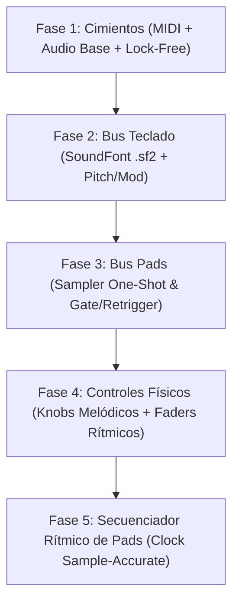

# Plan de Trabajo - ImpactSampler Studio

> Hoja de ruta para el desarrollo de la aplicación de escritorio de baja latencia con **Tauri v2 + Rust + React/TypeScript** para el controlador **Nektar Impact LX49+**.

---

## 1. Estrategia de Verificación y Hardware (Fase 1)

### ¿Debe estar conectado el controlador en la Fase 1?
* **Sí, es altamente recomendable.** Tener el cable USB conectado nos permitirá validar de forma inmediata que Windows expone el puerto MIDI, que `midir` se enlaza correctamente y que los paquetes de datos físicos (teclas, pads, faders) llegan sin pérdidas ni jitter.
* *(Nota: El código incluirá un modo de simulación/mock para desarrollo en caso de no tener el hardware conectado en algún momento).*

### ¿Habrá UI o será por consola?
* Implementaremos un **enfoque híbrido en dos pasos**:
  1. **Sniffer CLI (Consola):** Un ejecutable/modo rápido en Rust (`cargo run --bin sniffer`) que en cuestión de segundos enumerará los puertos MIDI de Windows y mostrará en consola en tiempo real los mensajes capturados al presionar teclas, golpear pads o mover faders. Esto valida la capa de hardware y drivers sin interferencia del frontend.
  2. **UI Base (Tauri v2):** La ventana de la aplicación mostrará un panel inicial con el selector de dispositivo MIDI, selector de salida de audio WASAPI y un monitor visual en tiempo real de eventos recibidos.

---

## 2. Fases de Desarrollo

---

---

### Fase 1: Cimientos del Sistema (MIDI, Audio Engine & Core Lock-Free) ✅ [COMPLETADA]

* **Objetivo:** Establecer la infraestructura de comunicación de baja latencia entre el hardware, el motor de audio y la UI.
* **Entregables Logrados:**
  * Estructura base Tauri v2 (Rust + React/Tailwind/Vite).
  * Detección y filtrado de puertos del Nektar Impact LX49+ (aislamiento del puerto primario para evitar duplicación de notas con `MIDIIN2`).
  * Mapeo verificado de hardware: 49 teclas (C1-C5), 8 Pads MPC (P1-P4 abajo, P5-P8 arriba), 9 Faders (CC 38-46), 8 Knobs (CC 56-63), Pitch Bend y Mod Wheel.
  * Motor de audio WASAPI multi-formato (`F32`, `I16`, `U16`) con canal lock-free `rtrb` SPSC.
  * Oscilador armónico aditivo enriquecido (fundamental + armónicos) audible al 100% en altavoces de PC y auriculares.
  * Interfaz interactiva completa: teclas con glissando, pads clickeables, faders y knobs arrastrables, pitch bend con resorte automático a 0.
  * Ventana maximizada por defecto y monitor MIDI en tiempo real.

---

### Fase 2: Bus Melódico del Teclado (Motor SoundFont .sf2 & Watchdog Hot-Plug) ✅ [COMPLETADA]

* **Objetivo:** Dotar a las 49 teclas del Nektar Impact LX49+ de sonido polifónico de alta fidelidad basado en muestras reales `.sf2`, integrando una experiencia de usuario (UX/UI) minimalista y blindaje de audio ante desconexiones.
* **Entregables Logrados:**
  * **Pantalla de Inicio / Selector Minimalista:**
    * Tarjetas sobrias para los 3 instrumentos en `soundfonts/`:
      1. 🎹 **Grand Piano** (`Piano - Realtime.sf2` • 126 MB • Steinway Samples)
      2. ⚡ **Rhodes Mark I** (`Rhodes (from Dream Piano).sf2` • 522 MB • 70s Vintage Electro-Mechanic)
      3. 📼 **Mellotron Tape** (`Mellotron.sf2` • 116 MB • 12 Vintage Presets)
    * Barra de carga ultrafina con reporte de progreso no bloqueante.
    * Botón en `Header` para hot-switching de instrumento en caliente durante la sesión.
    * Selector de parches/presets dinámico en el `Header` para bancos multi-instrumento (como los 12 timbres del Mellotron).
  * **Delimitación de Rango Físico del Mellotron:**
    * Teclado virtual adaptado al rango útil de 35 notas de cinta (**Notas 43 a 77: G2 a F5**).
    * Teclas fuera de rango atenuadas con sombra noir y desactivadas para emular la mecánica real de cinta.
  * **Motor de Render SoundFont 2 (Backend Rust con `rustysynth` v1.3.7):**
    * Síntesis estéreo de 32-bit float en el hilo de audio con buffers pre-alocados zero-alloc.
    * Note On con curvas de velocidad dinámicas, Note Off, Pitch Bend continuo, Mod Wheel (CC 1) y Sustain Pedal (CC 64).
  * **Watchdog de Auto-Recuperación de Audio (Hot-Plug & Reconnect):**
    * Hilo guardián en background que detecta invalidación de endpoint WASAPI (`AUDCLNT_E_DEVICE_INVALIDATED`).
    * Reconstrucción automática del stream en cuanto Windows restaura el dispositivo sin requerir reiniciar la app.
    * Preservación atómica de estado: preserva el SoundFont cargado en RAM, el preset activo y el volumen master.
    * Indicador visual dinámico en el `Header` (verde esmeralda activo / ámbar buscando salida).

---

### Fase 3: Bus Rítmico de Pads (Sampler PCM: One-Shot & Gate/Retrigger & Drum Kit SF2) ✅ [COMPLETADA]

* **Objetivo:** Implementar los 8 slots de samples para percusión y efectos sonoros asociados a los pads físicos con soporte multi-motor.
* **Entregables Logrados:**
  * **Motor Sampler PCM Zero-Alloc en Rust (`src-tauri/src/audio/sampler.rs`):**
    * Decodificación de archivos `.wav` (16-bit, 24-bit, 32-bit float) con `hound`.
    * Resampling lineal offline automático al sample rate nativo del stream activo de WASAPI.
    * 8 slots de memoria continua con buffer estéreo y mezcla de baja latencia sin alocaciones en el hilo de audio.
    * Lógica de reproducción por voz dual:
      * **One-Shot:** Reproducción completa del sample ignorando Note-Off con retrigger instantáneo libre de clicks.
      * **Gate:** Suena mientras el pad se mantiene presionado y corta con micro-fadeout suave de 5 ms al soltar.
  * **Arquitectura de Tres Modos Rítmicos:**
    1. **WAV SAMPLER:** Cada pad reproduce su archivo `.wav` independiente con modo configurable.
    2. **DRUM SF2:** Reproducción de batería SoundFont independiente (`Yamaha_RX7_Drums.sf2`) mapeando los 8 pads a Kick, Snare, Closed HH, Open HH, Clap, Low Tom, High Tom y Crash sin interrumpir el piano melódico en las teclas.
    3. **MIRROR:** Los pads duplican las notas del teclado para tocar el SoundFont cromático.
  * **Kit de Fábrica Precargado (`samples/`):**
    * 8 muestras acústicas y electrónicas de alta fidelidad generadas y cargadas en RAM por defecto (Kick, Snare, Clap, Closed Hat, Open Hat, Low Tom, High Tom, Perc).
  * **UI Minimalista Noir-Tech y Ergonomía UX:**
    * Selector de modos tipográfico sobrio (`WAV SAMPLER  |  DRUM SF2  |  MIRROR`) en la cabecera superior sin emojis ni pills abultadas.
    * Pads limpios sin etiquetas redundantes "P1".."P8", mostrando el nombre del sample y modo de reproducción.
    * Iluminación perimetral idéntica al hardware Nektar Impact LX49+: borde verde esmeralda translúcido en reposo (`border-emerald-500/30`) y conmutación instantánea a rojo brillante reactivo (`border-red-500`) al ser golpeado.
    * Menú contextual mediante **clic derecho** sobre cualquier pad: Cargar sample WAV nativo (`rfd`), alternar One-Shot/Gate y vaciar slot.
    * Soporte para **Drag & Drop** de archivos `.wav` con highlight perimetral cian reactivo.
    * Persistencia de los 8 slots de samples a través del watchdog de audio WASAPI ante desconexiones de hardware.

---

### Fase 4: Modulación, FX Rack Modular y Ruteo de Mezcla ✅ [COMPLETADA]

* **Objetivo:** Implementar la matriz física completa para procesar en vivo el instrumento del teclado y los pads con DSP de alta fidelidad, asignaciones dinámicas y ruteo selectivo.
* **Entregables Logrados:**
  * **Rack de Efectos Estéreo Zero-Alloc en Rust (`src-tauri/src/audio/fx.rs`):**
    * **Filtro Paso Bajo:** Topología virtual analógica estilo Moog Ladder de 4 polos (24 dB/oct) con resonancia autolimitada (Cutoff 40 Hz - 18 kHz).
    * **Warm Drive:** Saturación analógica cálida no lineal con función `tanh` suave.
    * **Reverb Estéreo:** Motor Schroeder-Moorer (Freeverb) con 8 filtros peine (*comb*) y 4 filtros paso-todo (*all-pass*) con difusión estéreo.
    * **Delay Estéreo con Feedback:** Delay de buffer circular modulable con filtro paso-bajo en el lazo de realimentación (40 ms a 1 s).
    * **Chorus Estéreo:** Modulación LFO sinusoidal en cuadratura (90° fase estéreo) con doble línea de retardo interpolada.
    * **Panorámica Estéreo:** Panning continuo con ley de paneo sinusoidal de potencia constante (-3 dB en el centro).
  * **Knobs K1 - K8 Reasignables Dinámicamente:**
    * Mapeo físico verificado con el Nektar Impact LX49+ (CC 56 a 63).
    * Configuración de fábrica optimizada: K1: Cutoff, K2: Resonancia, K3: Drive, K4: Reverb Mix, K5: Delay Time, K6: Delay Feedback, K7: Delay Mix, K8: Paneo.
    * Menú contextual mediante **clic derecho** sobre cualquier knob en la UI para reasignarlo instantáneamente a cualquiera de los 9 parámetros del rack de efectos.
  * **Faders F1 - F9 de Mezcla en Tiempo Real:**
    * F1 a F8 controlan la ganancia individual de cada uno de los 8 slots de pads (0 a 1.5x) con respuesta lineal y suave.
    * F9 controla el volumen Master global del sistema (0 a 100%).
  * **Selector de Ruteo FX de 3 Pasos (`KEYS | BOTH | PADS`):**
    * Selector minimalista integrado en la cabecera de los knobs.
    * `KEYS`: Los efectos procesan únicamente el sintetizador melódico; los pads pasan en seco (*dry*).
    * `BOTH`: Suma estéreo master completa a través del rack de efectos.
    * `PADS`: Los efectos procesan exclusivamente el bus rítmico de percusión/sampler.
    * Ejecución lock-free mediante buffers dedicados en el motor de audio sin alocaciones dinámicas ni pausas.
* **Criterio de Aceptación:**
  * Manipular los knobs K1-K8 y faders F1-F9 modula el sonido en tiempo real con 0 latencia perceptible y respuesta fluida.
  * El cambio de ruteo y reasignación de knobs opera sin cortes, clicks ni degradación del rendimiento.

---

### Fase 5: Secuenciador Rítmico de Pads (Step Sequencer en Tiempo Real) ✅ [COMPLETADA]

* **Objetivo:** Permitir que los 8 pads ejecuten loops y patrones rítmicos sincronizados mientras se toca libremente el teclado con el SoundFont melódico, controlado directamente desde los botones de transporte físico y los 9 botones asignables (B1..B9) del Nektar Impact LX49+.
* **Entregables Logrados:**
  * **Reloj Zero-Jitter Sample-Accurate en Rust (`src-tauri/src/audio/sequencer.rs`):**
    * Reloj de alta precisión integrado directamente en `render_internal` contando muestras a 48,000 Hz ($0\%$ CPU adicional, $0$ alocaciones en hilo de audio).
    * Disparo inmediato en **frame cero exacto** al dar Play (**0 ms de latencia inicial**).
    * Patrón rítmico expandido a **16 pasos** y 8 pistas correspondientes a los 8 pads (Kick a Ride / WAV Sampler).
    * **Grilla inicial 100% limpia** al iniciar la aplicación (sin patrones precargados).
    * **Selector de resolución de rejilla (*Grid*):**
      * **Modo 1/8 (Corcheas):** 16 pasos = 2 compases completos de 4/4 (8 tiempos de negra).
      * **Modo 1/16 (Semicorcheas):** 16 pasos = 1 compás completo de 4/4.
      * **Modo 1/32 (Fusas):** 16 pasos = 2 tiempos de negra (medio compás), ideal para *hi-hat trap rolls* ultraprecisos.
    * **Groove Swing MPC 58% Sample-Accurate:**
      * Desfase temporal dinámico de micro-timing clásico Akai (+16% paso par, -16% paso impar) calculado a nivel de muestras sin deriva de reloj.
    * Rango de tempo dinámico de 40 a 300 BPM con algoritmo de Tap Tempo suave.
  * **Metrónomo Sonoro Clic Dry Sintético (Audio Click Track):**
    * Generador de impulsos senoidales analógicos con decaimiento percusivo exponencial de ~18 ms sintetizado directamente en el callback de audio.
    * Frecuencias calibradas: **1600 Hz** en el primer pulso del compás (*downbeat*) y **850 Hz** en los pulsos secundarios de negra.
    * Enrutado limpio (*dry*) directamente a la salida estéreo sin pasar por los efectos de reverberación o delay, garantizando máxima inteligibilidad rítmica.
  * **Sistema de Doble Banco de Patrones (Pattern Bank A / B):**
    * Almacenamiento independiente en RAM para el Banco A y el Banco B.
    * **Clonación Inteligente:** Al alternar por primera vez al Banco B, clona automáticamente el ritmo del Banco A para permitir crear variaciones o cortes inmediatos sin empezar de cero.
  * **Integración Hardware Completa con el Nektar Impact LX49+ (15 Controles Físicos):**
    * **Botones de Transporte (CC 102 a 107):**
      * `CC 102 (Cycle)`: Tap Tempo.
      * `CC 103 (Rewind)`: Disminuir tempo en 1 BPM.
      * `CC 104 (Forward)`: Aumentar tempo en 1 BPM.
      * `CC 105 (Stop)`: Detener reproducción y rebobinar al paso 1.
      * `CC 106 (Play)`: Iniciar / Pausar secuencia (o barra espaciadora en teclado de computadora).
      * `CC 107 (Record)`: Grabación Overdub en tiempo real con **cuantización al 50% hacia el paso más cercano** y **Full Level 127** unificado (misma pegada máxima tanto al tocar en vivo como en la reproducción grabada).
    * **9 Botones Asignables Físicos B1..B9 (CC 47 a 55):**
      * `B1 (CC 47)`: **Audio Clic ON/OFF** (activa/desactiva el metrónomo sonoro).
      * `B2 (CC 48)`: **Grid 1/8** (resolución de corcheas - 2 compases).
      * `B3 (CC 49)`: **Grid 1/16** (resolución de semicorcheas - 1 compás).
      * `B4 (CC 50)`: **Grid 1/32** (resolución de fusas - 2 tiempos).
      * `B5 (CC 51)`: **Pattern Bank A / B** (alterna entre banco A y B).
      * `B6 (CC 52)`: **MPC Swing 58% ON/OFF** (alterna entre ritmo recto y groove MPC).
      * `B7 (CC 53)`: **Clear Selected Track** (borra únicamente la pista del pad actualmente seleccionado).
      * `B8 (CC 54)`: **Toggle Visual Metronome** (muestra u oculta el overlay numérico gigante).
      * `B9 (CC 55)`: **Clear All Pattern** (limpia por completo el patrón de 16 pasos del banco activo).
  * **Metrónomo Visual Radical (Giant Overlay Full-Screen):**
    * Overlay minimalista proyectado a pantalla completa marcando los pulsos principales de negra ($1 \dots 8$ en 1/8, $1 \dots 4$ en 1/16, o $1 \dots 2$ en 1/32) con destello en el downbeat.
    * Sincronizado estrictamente al motor Rust y conmutable mediante botón UI o botón físico B8 (`CC 54`).
  * **Cuadrícula Rítmica Noir-Tech (`src/components/StepSequencer.tsx`):**
    * 8 filas de pads con nombres de instrumentos, botón de audición rápida y selección interactiva de pista activa (halo esmeralda neón).
    * Badges interactivos para Banco A/B (Cian / Púrpura), botón de Clic con LED sonoro ámbar, botón de Swing MPC 58% con LED rosa y botón de Overlay.
    * Selector visual de resoluciones `GRID: [ 1/8 | 1/16 | 1/32 ]`.
    * Botón `CLR P{n}` para borrado rápido de la pista activa y botón general de borrado.
* **Criterio de Aceptación:**
  * Reproducción estable y sin deriva temporal a cualquier tempo.
  * Tocar pads en vivo o disparar melodías en el teclado mientras el secuenciador corre con clic y swing funciona con 0 latencia y total solidez.

---

### Fase 5.1: Unificación Monolítica de Hardware & Ergonomía Noir-Tech (Completada ✅)
* **Objetivo:** Integrar el secuenciador rítmico y el controlador superior dentro de un único chasis de hardware continuo con ergonomía de vista única (cero scroll vertical).
* **Entregables y Mejoras Implementadas:**
  1. **Consola Monolítica Unificada:**
     - `HardwareSkeleton.tsx` ahora aloja a `StepSequencer.tsx` como componente acoplado directamente en el chasis físico, compartiendo la misma estructura de carcasa analógica.
     - `workstationMode` (`"keys"` vs `"seq"`): oculta el teclado de 49 teclas al entrar en modo secuenciador para concentrar toda la atención en la bahía rítmica sin duplicidad visual.
  2. **Pads de Silicona y Botones TR Mecánicos:**
     - 8 pads de silicona con bajo relieve, biselado táctil y underglow orgánico diferenciado por rol cromático (Kick, Snare, HiHats, Toms, Platillos).
     - 16 botones mecánicos TR con alternancia tonal clásica Roland (grafito y titanio), pips de acento en Downbeats (1, 5, 9, 13) y lentes LED internas centradas de alta respuesta visual.
  3. **Corrección de Estabilidad del Teclado:**
     - Eliminado el salto vertical/desplazamiento del riel de teclas al pulsar cualquier nota (`overflow-y-hidden` y anclaje físico de base).
  4. **Optimización de Espacio Vertical (Ajuste Zero-Scroll):**
     - Remoción de la regla superior de compases y de la fila numérica 1..16 para ganar ~60px verticales. Los 8 tracks arrancan de inmediato con lectura directa.
     - Calibración de altura por pista a `h-9 / h-9.5` (36px) con `gap-1.5`. Todo el instrumento (cabecera con faders/knobs + drum machine + barra de docking) queda 100% visible en una sola pantalla.
  5. **Barra de Docking Inferior Reorganizada:**
     - Selectores de modo minimalistas tipo serigrafía retro: `KEYS` y `SEQ`.
     - Selector de Kit reubicado en la barra con LED de estado y dropdown emergente hacia arriba (`Yamaha RX7` / `Custom WAV`).
     - Selector de banco compacto: `BANK A` / `BANK B`.
     - Selector de grid cíclico: `GRID 1/16 ▾` (1/8, 1/16, 1/32).

---

### Fase 5.2: Refinamientos de Diseño, MIDI Learn & Blindaje de Hardware ✅ [COMPLETADA]
* **Objetivo:** Perfeccionamiento estético y atmosférico de la consola, integración de nuevos instrumentos de estudio, implementación del sistema universal de MIDI Learn sin contaminación visual y blindaje total de la conexión MIDI ante desconexiones físicas en caliente (Hot-Plug).
* **Entregables y Mejoras Implementadas:**
  1. **Centrado Ergonómico de Consola ("Floating Masterpiece"):**
     - Eliminación de áreas muertas en modo `KEYS`.
     - Contenedor principal (`<main>`) centrado vertical y horizontalmente (`justify-center items-center my-auto`), otorgando presencia de consola de hardware flotante.
  2. **Atmósfera Noir-Tech Multicapa (Fondo de Estudio):**
     - **Canvas Base:** Negro puro `#050507` / `#070709` de máximo contraste.
     - **Iluminación Cenital (*Studio Overhead Spotlight*):** Gradiente radial blanco sutil en el borde superior emulando iluminación real de sala de control.
     - **Micro-Malla Acústica (*Precision Dot Matrix*):** Patrón de micro-perforaciones acústicas de 1.2px espaciadas a 28px con máscara elíptica de alta definición.
     - **Aura Reactiva Dinámica al Instrumento Activo:** Resplandor ambiental de fondo que cambia de color según el timbre seleccionado:
       * 🎹 *Grand Piano:* Ámbar dorado cálido (`rgba(245, 158, 11, 0.20)`).
       * ⚡ *Rhodes Mark I:* Cian electro-mecánico (`rgba(6, 182, 212, 0.20)`).
       * 📼 *Mellotron M400:* Rosa vintage cinta magnética (`rgba(244, 63, 94, 0.20)`).
       * 🥁 *Yamaha RX7:* Púrpura neón digital (`rgba(168, 85, 247, 0.22)`).
     - **Viñeta Perimetral Profunda:** Enmarcado óptico que enfoca la atención del usuario en el hardware central.
  3. **Splash Screen Inicial Cinematográfico & Presentación Atómica:**
     - Pantalla de bienvenida en negro puro con el logotipo `IMPACT SAMPLER` en tipografía de alta fidelidad y acento esmeralda neón.
     - Temporizado cinematográfico de 3 segundos con transición fade-out fluida (`opacity-0 scale-110 blur-sm`) de 700 ms hacia la consola.
     - **Solución definitiva al destello/flicker gris de WebView2:** La ventana de Tauri se configura para iniciar invisible (`visible: false` en `tauri.conf.json`) y se revela atómicamente mediante el comando nativo `show_main_window` una vez que el DOM negro del splash está 100% montado y renderizado, garantizando un arranque impecable y profesional.
  4. **Catálogo Fotográfico PNG en el Selector Modal de Instrumentos (`InstrumentSelectModal.tsx`):**
     - Integración de renders fotográficos de estudio en alta resolución con fondo transparente para cada instrumento:
       * 🎹 **Grand Piano:** Fotografía de piano de cola acústico de concierto (`piano.png`).
       * ⚡ **Rhodes Mark I:** Fotografía de piano electro-mecánico vintage de los años 70 (`rhodes.png`).
       * 📼 **Mellotron M400:** Fotografía de reproductor de cintas analógicas de culto (`melotron.png`).
       * 🥁 **Yamaha RX7:** Fotografía de la mítica caja de ritmos digital PCM de 1987 (`yamaharx7.png`).
     - Tarjetas interactivas con iluminación perimetral, escala suave al pasar el cursor (*hover micro-interaction*) y halo luminoso dinámico según el instrumento.
     - **Comportamiento inteligente de flujo:** Al seleccionar el Yamaha RX7, la consola conmuta automáticamente al modo Secuenciador (`SEQ`), permitiendo empezar a programar ritmos de inmediato sin clics adicionales.
  5. **Display OLED Hardware de Instrumentos & Presets (`HardwareSkeleton.tsx`):**
     - Pantalla empotrada en el chasis superior sobre la matriz de 8 Knobs con marco sobrio de hardware oscuro (`border-white/10`).
     - Muestra el instrumento activo (`INST: YAMAHA GRAND PIANO`, `MELLOTRON M400`, etc.) con LED esmeralda neón y acceso directo al catálogo de SoundFonts.
     - Selector de parches analógico (`PATCH: 001 - FLUTE`) con LED ámbar para bancos multi-instrumento.
  6. **Depuración Serigráfica y Controles Táctiles:**
     - Eliminación de etiquetas redundantes y ampliación del área vertical de faders a `h-28` (112px).
     - Reseteo a valores nominales por **doble clic** en faders y knobs (ganancia unitaria, paneo central y volumen al 80%).
     - Fader Master 9 con borde e iluminación cian dedicada.
     - Tipografía de alta gama Geist Sans y Geist Mono con cifras tabulares (`tabular-nums`) para 0 jitter horizontal.
  7. **Sistema Universal de MIDI Learn Minimalista:**
     - **Botón `MIDI LEARN` en el Header:** Botón limpio que al activarse resplandece en ámbar dorado con LED pulsante, sin banners invasivos ni desplazamiento de elementos.
     - **Faders 1–8 y Master Fader 9:** Resplandor de contorno ámbar en reposo (`border-amber-500/50`) y halo pulsante brillante (`border-2 border-amber-400 animate-pulse`) al seleccionarse para escucha de CC, manteniendo los números de valor limpios sin etiquetas `CC ..` sobrecargadas.
     - **Knobs 1–8:** Halo perimetral ámbar reactivo que pulsa al esperar movimiento de perilla física en cualquier controlador.
     - **Pads 1–8 en Secuenciador Rítmico:** Los slots de las pistas adquieren contorno ámbar elegante; al hacer clic, pulsan esperando la nota/pad del hardware externo sin tapar los nombres de las muestras.
     - **Sincronización Lock-Free en Rust:** Asignaciones de CC transferidas directamente al hilo de audio (`set_midi_learn_mappings`) a 0% CPU.
     - **Persistencia en `localStorage` & Restablecimiento de Fábrica:** Mapeos guardados automáticamente en el navegador y opción «Restablecer de Fábrica» ubicada de manera ordenada en el modal de Configuración (`AudioSettingsModal.tsx`), devolviendo instantáneamente el sistema a los estándares del Nektar LX49+.
  8. **Blindaje de Hardware en Caliente (MIDI Hot-Plug Watchdog):**
     - **Hilo Guardián `midi-watchdog` (0.00% CPU):** Hilo en segundo plano en Rust suspendido con `std::thread::sleep(1200ms)`. Al despertar, realiza una lectura ultra-rápida de 20 nanosegundos en el subsistema PnP de Windows.
     - **Detección Inmediata de Desconexión:** Al desconectar físicamente el cable USB, destruye de inmediato las conexiones huérfanas en Windows y notifica a la UI (`midi-status-changed`), cambiando el monitor del Header a **ámbar** (*«Desconectado»*).
     - **Reconexión Automática Transparente:** En cuanto el cable USB se reenchufa, el watchdog detecta el puerto, limpia los manejadores, reconecta de inmediato sin bloqueos y devuelve el monitor a **verde esmeralda** (*«Impact LX49+»*).
     - **Re-escaneo Activo:** Comando `rescan_midi_ports` vinculado al botón «Re-escanear» de Settings para forzar reconexión manual si se desea.

---

## 3. Próximo Paso Inmediato
Fases 1 a 5.2 completadas al 100%. La plataforma cuenta con motor melódico SoundFont, motor de percusión PCM / Drum SF2, secuenciador por pasos TR-style, rack de efectos modular, sistema universal de MIDI Learn y blindaje de audio y MIDI ante desconexiones. Listo para definir las prioridades de la **Fase 6** (ej. exportación de audio/loops WAV, controles de Mute/Solo por pista, afinación/decay por pad o nuevas expansiones de instrumentos).

