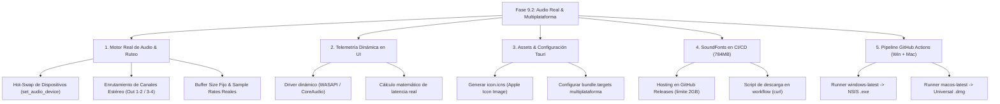
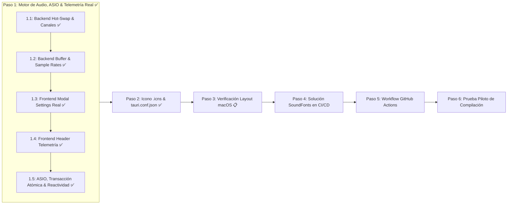

# Plan de Trabajo - Fase 9.2: Preparación Multiplataforma, Motor de Dispositivos de Audio & Pipeline de Empaque Universal

> **Estado:** Fase Activa / En Progreso  
> **Objetivo:** Transformar el subsistema de audio y la interfaz de ImpactSampler Studio en un entorno 100% operativo y agnóstico al sistema operativo. Esto incluye la selección real de interfaces de audio (Hot-Swap en caliente sin reinicio), enrutamiento de canales estéreo en interfaces multicanal, control de Buffer Size y Sample Rate basados en las capacidades físicas del hardware, telemetría dinámica en la consola y la integración de un pipeline de CI/CD automatizado con GitHub Actions que compile simultáneamente para **Windows (instalador NSIS `.exe`)** y **macOS (imagen de disco Universal `.dmg`)**.

---

## 1. Contexto y Diagnóstico Inicial

La versión actual (v1.0.0) de ImpactSampler Studio ha alcanzado un nivel de madurez técnica que supera con creces el estado de MVP. La arquitectura de audio y control MIDI en Rust (`cpal`, `midir`, `rtrb`, `hound`, `rustysynth`) es multiplataforma por naturaleza:
- En Windows interactúa con **WASAPI** y la API WinMM/UWP.
- En macOS interactuará automáticamente con **CoreAudio** y **CoreMIDI**.

Sin embargo, tras una exhaustiva auditoría forense del código, se identificaron brechas críticas que deben ser subsanadas antes de la distribución multiplataforma:

1. **Configuración de Audio Simulada en la UI:**
   - En `AudioSettingsModal.tsx`, al seleccionar una interfaz externa y presionar "Listo", el botón solo ejecuta `onClick={onClose}` sin invocar ningún comando de Rust.
   - En `src-tauri/src/main.rs` no existe ningún comando (`set_audio_device`) para ordenar el cambio de tarjeta o interfaz.
   - El motor (`engine.rs`) siempre inicia ciegamente con `host.default_output_device()` (altavoces internos de la PC) e ignora la interfaz externa conectada.
2. **Buffer Size y Sample Rates Fijos en Backend:**
   - `buffer_size` está fijado en `256` en `engine.rs` y nunca se reconfigura en el stream de audio.
   - `list_output_devices` reporta una lista estática ficticia (`[44100, 48000, 96000]`) en lugar de interrogar las capacidades reales del hardware (`device.supported_output_configs()`).
   - Al construir el stream no se solicita `cpal::BufferSize::Fixed(...)`, dejando el buffer a criterio no controlado del sistema operativo.
3. **Ausencia de Ruteo de Canales en Interfaces Multicanal:**
   - En interfaces de estudio con 4 o más salidas (ej. Focusrite Scarlett 4i4, Behringer UMC404, Komplete Audio 6), la aplicación carece de selector para enrutar el máster estéreo al par deseado (Canales 1-2 vs Canales 3-4).
4. **Telemetría Rígida en el Header:**
   - `Header.tsx` mantiene quemado el texto `"WASAPI"` y la latencia `"≤ 5.3 ms"`, lo cual es incorrecto tanto en macOS (CoreAudio) como en Windows cuando se modifica el buffer.
5. **Configuración de Empaque y SoundFonts:**
   - `tauri.conf.json` está restringido a `"targets": ["nsis"]` y carece del bundle `.icns`.
   - Los 4 SoundFonts oficiales suman **~784 MB** y están en `.gitignore` debido al límite de 100 MB de GitHub, requiriendo inyección automatizada durante el CI/CD.

---

## 2. Objetivos Específicos de la Fase 9.2

---

## 3. Especificaciones Técnicas Detalladas

### 3.1. Motor de Dispositivos de Audio & Enrutamiento en Rust (`engine.rs`)
* **Hot-Swap Atómico de Dispositivo (`set_audio_device`):**
  * Detener el stream activo (`StreamHolder`) de forma segura.
  * Localizar el dispositivo solicitado por nombre en `host.output_devices()`.
  * Reconstruir el stream aplicando la misma preservación atómica de estado del watchdog:
    * Conservar SoundFont cargado en RAM, banco y preset melódico activo.
    * Conservar los 8 slots de samples WAV de pads y sus ganancias.
    * Conservar el drum kit SoundFont de pads.
    * Conservar los parámetros del rack FX (Filtro DJ, Tube Drive, Reverb, Delay) y ruteo.
    * Conservar el volumen master y estado del secuenciador.
* **Control Real de Buffer Size & Sample Rate:**
  * Consultar `device.supported_output_configs()` para entregar al frontend únicamente los sample rates reales que admite el DAC del hardware seleccionado.
  * Configurar `StreamConfig` con `cpal::BufferSize::Fixed(requested_buffer)` para garantizar que el hardware responda a la latencia solicitada.
* **Enrutamiento Estéreo de Canales de Salida (Output Channel Routing):**
  * Detectar el número total de canales físicos expuestos por el dispositivo (`config.channels`).
  * Si `channels == 2`, operar en modo directo (Canales 1-2).
  * Si `channels >= 4`, exponer selector de par estéreo:
    * Par 0: Salidas 1-2 (Master Monitors).
    * Par 1: Salidas 3-4 (Headphones / Cue).
  * En el callback de audio (`render_f32`), escribir las muestras estéreo en los índices del par seleccionado, rellenando con ceros los canales no utilizados.

### 3.2. Rediseño Operativo de `AudioSettingsModal.tsx`
* **Arquitectura de UI en Primer Nivel:**
  1. **Dispositivo de Salida (Audio Device):** Selector principal con estado de conexión y reconexión reactiva.
  2. **Canales de Salida (Output Channels):** Aparece de forma condicional cuando el dispositivo seleccionado tiene más de 2 canales.
  3. **Sistema de Audio (Audio Host):** Badge informativo dinámico (`WASAPI (Windows Nativo)` o `CoreAudio (macOS Nativo)`).
  4. **Tamaño de Buffer & Sample Rate:** Selectores vinculados directamente a las capacidades reportadas por el backend.
  5. **Botón «Aplicar y Guardar»:** Guarda la configuración en `localStorage` (`impact_sampler_preferred_device`, `buffer_size`, `sample_rate`, `output_channel_pair`) y despacha la orden a Rust, aplicando los cambios en tiempo real sin reiniciar la aplicación.

### 3.3. Telemetría Dinámica en `Header.tsx`
* **Driver Agnóstico:** Mostrar dinámicamente `{audioStatus?.driver ?? "AUDIO"}` en lugar de `"WASAPI"`.
* **Cálculo Defensivo de Latencia:**
  $$\text{Latencia (ms)} = \left( \frac{\text{bufferSize}}{\text{sampleRate}} \right) \times 1000$$
  * Si `bufferSize > 0` y `sampleRate > 0`, formatear a un decimal fijo (`≤ X.X ms`).
  * Si el motor está reconectando o los valores son transitorios, mostrar `"Buscando..."`.

### 3.4. Assets, Empaque y Pipeline de CI/CD
* **Iconografía:** `icons/icon.icns` compilado para macOS a partir de `src-tauri/icons/icon.png`.
* **Targets:** `"targets": "all"` en `tauri.conf.json` con `"nsis"` para Windows y `"dmg"` para macOS.
* **SoundFonts en CI/CD:** Alojamiento de los 4 `.sf2` (784 MB) en un Release de GitHub (margen de hasta 2 GB por archivo) con inyección automatizada por `curl`.
* **Workflow:** `.github/workflows/build.yml` con matriz `windows-latest` y `macos-latest` (`universal-apple-darwin`).

---

## 4. Plan de Pasos de Implementación Modular

### Paso 1: Motor Real de Dispositivos de Audio, Canales, Latencia y Telemetría ✅ [COMPLETADO]
* **Subpaso 1.1: Backend Rust - Hot-Swap de Dispositivos & Enrutamiento de Canales (`engine.rs` + `main.rs`) ✅ [COMPLETADO]:**
  * Implementado comando Tauri `set_audio_device(device_name: Option<String>)` con hot-swap atómico en caliente.
  * Preservación atómica total del estado de RAM (SoundFonts cargados, banco, presets, 8 slots WAV de pads, modos de pad, ganancias individuales, drum kit SoundFont, parámetros del rack FX, ruteo y secuenciador rítmico).
  * Implementado `set_channel_pair(pair: usize)` y mapeo en `render_f32`, `render_i16` y `render_u16` para direccionar a canales `pair * 2` y `pair * 2 + 1` en interfaces multicanal ($\ge 4$ canales), silenciando con ceros los canales inactivos.
  * Consulta real del número de canales del DAC expuesto en `AudioDeviceInfo.channels`.
* **Subpaso 1.2: Backend Rust - Detección Real de Sample Rates y Buffer Size Fijo (`engine.rs` + `main.rs`) ✅ [COMPLETADO]:**
  * Detección real de frecuencias de muestreo soportadas por el hardware activo mediante iteración sobre `device.supported_output_configs()`.
  * Configuración del stream con `cpal::BufferSize::Fixed(requested_buffer)` para garantizar la latencia de hardware requerida.
  * Implementados métodos y comandos Tauri `set_audio_buffer_size` y `set_audio_sample_rate`.
  * Re-cálculo dinámico de bases de tiempo en todos los módulos DSP (`AudioFxRack`, `StepSequencer`, `Arpeggiator`, `PadSampler`) al cambiar la frecuencia de muestreo.
  * Hilo guardián (`audio-watchdog`) adaptado para preservar tanto el dispositivo como el buffer y sample rate elegidos ante desconexiones físicas.
* **Subpaso 1.3: Frontend Modal - Rediseño UX y Conexión Real de `AudioSettingsModal.tsx` ✅ [COMPLETADO]:**
  * Eliminación de botones cosméticos WASAPI/ASIO no funcionales.
  * **Bloque 1: Dispositivo de Audio y Salidas:** Selector principal de `Audio Device` y selector dinámico de salidas físicas (`Output Channels`: `Out 1/2 (Main)`, `Out 3/4 (Phones)`, etc.) para interfaces multicanal.
  * **Bloque 2: Rendimiento y Buffer de Hardware:** `Buffer Size` (`64, 128, 256, 512, 1024 samples`) con cálculo dinámico de latencia en milisegundos y `Sample Rate` poblado con las frecuencias reales reportadas por el DAC.
  * Integridad total de los bloques MIDI (selección de puertos, calibración asistida de 8 golpes y restablecimiento de mapeos hardware intactos).
  * Botones **«Cancelar»** y **«Aplicar y Guardar»** con feedback de carga (`isApplying`), persistencia atómica en `localStorage` (`impact_sampler_audio_preferences`) y arranque seguro en `App.tsx` con fallback transparente a los altavoces internos si la interfaz externa no está conectada.
* **Subpaso 1.4: Frontend Header - Telemetría en Vivo & Latencia Real (`Header.tsx`) ✅ [COMPLETADO]:**
  * Visualización prioritaria en el monitor del Header del **Dispositivo de Audio Activo** (ej. `Focusrite Scarlett 4i4`, `Volt 2`, `Altavoces Realtek`), permitiendo al usuario saber instantáneamente por dónde sale el sonido.
  * Cálculo dinámico de latencia en vivo: $\text{Latencia} = (\text{bufferSize} / \text{sampleRate}) \times 1000 \text{ ms}$ (ej. `~1.3 ms`, `~2.7 ms`, `~5.3 ms`).
  * Frecuencia en kHz (`48kHz`, `96kHz`) y estado reactivo `"Reconectando..."` / `"Buscando"` con animación de pulso ámbar ante desconexiones.
  * Tooltip informativo completo en hover: `{deviceName} ({driver}) · {channels} canales · Buffer: {bufferSize} · {sampleRate}Hz`.
* **Subpaso 1.5: Soporte Nativo de Drivers ASIO, Transacción Atómica (`set_audio_config`) & Reactividad en Caliente en Modal ✅ [COMPLETADO]:**
  * **Toolchain & Compilación ASIO en Rust:** Integración de bindings C/C++ de Steinberg ASIO SDK en Rust (`asio-sys` y `cpal` con feature `asio` en Windows).
  * **Comando IPC Atómico Unificado (`set_audio_config`):** Selección de host (`WASAPI` / `ASIO`), dispositivo, par estéreo, buffer y sample rate aplicados en una transacción unificada y libre de condiciones de carrera.
  * **Liberación de Audio Estilo REAPER (`suspend_audio_engine` / `resume_audio_engine`):** Detención del stream y liberación de buffers al abrir el modal para desbloquear el DAC y permitir que el panel de control del fabricante (Zoom F3, etc.) altere el sample rate sin restricciones de exclusividad.
  * **Persistencia Nativa en Disco (`audio_preferences.json`):** Almacenamiento directo en el almacenamiento de la aplicación de las preferencias de audio en Rust, permitiendo que el motor arranque directamente en ASIO en una única conexión sin arrancar previamente en WASAPI ni generar chasquidos en el DAC.
  * **Reutilización Defensiva del Singleton COM de ASIO:** Reutilización del puntero del driver activo en `standby_asio_driver` para evitar llamadas redundantes a `load_driver` y descargas prematuras de `ASIOExit()` que enmudecían el stream.
  * **Memoria por Host en el Modal y Detección de Estado:** Memoria del último dispositivo seleccionado por host (`lastSelectedDeviceByHost`) y verificación defensiva de `isRunning` en `App.tsx` para sincronización limpia y transparente.

### Paso 2: Iconografía Apple y Configuración Tauri (`tauri.conf.json`) ✅ [COMPLETADO]
* **Objetivo:** Establecer la infraestructura de empaque nativo para macOS sin alterar ni degradar la configuración existente de Windows NSIS, generando los activos visuales para pantallas Retina y definiendo el empaquetado DMG ergonómico.
* **Entregables Logrados:**
  * **Tarea 2.1: Generación y Validación de la Iconografía Apple (`icon.icns`) ✅:**
    * Generación exitosa de `src-tauri/icons/icon.icns` (1.75 MB) con todas las capas Retina oficiales (16x16 a 512x512@2x = 1024x1024) mediante `@tauri-apps/cli icon`.
    * Preservación del `icon.ico` original de Windows para blindar la compatibilidad del instalador NSIS.
  * **Tarea 2.2: Configuración Multiplataforma en `tauri.conf.json` ✅:**
    * Actualizado `bundle.targets` a `["nsis", "dmg", "app"]`, desbloqueando macOS sin requerir WiX en entornos de desarrollo local Windows.
    * Registrado `"icons/icon.icns"` en el array `bundle.icon`.
  * **Tarea 2.3: Configuración Específica de macOS y Layout del DMG (`bundle.macOS`) ✅:**
    * Añadido bloque `bundle.macOS` con `minimumSystemVersion: "11.0"` (base de Apple Silicon M1+).
    * Añadido layout del DMG con `windowSize: { width: 540, height: 380 }`, posición de aplicación `{ x: 140, y: 170 }` y acceso a aplicaciones `{ x: 400, y: 170 }`.
  * **Tarea 2.4: Validación de Schema y No-Regresión en Windows ✅:**
    * Validación sintáctica y de schema completada satisfactoriamente.
    * Persistencia de `LIBCLANG_PATH` en el entorno de usuario y verificación exitosa de compilación con `cargo check` (código 0).

### Paso 3: Revisión de Adaptabilidad de Ventana en macOS ✅ [COMPLETADO]
* **Objetivo:** Garantizar que la ventana de la aplicación ofrezca una experiencia visual nativa e impecable en macOS sin colisiones entre los controles de semáforo del sistema operativo y los componentes de la interfaz de usuario, preservando la proporción y legibilidad en pantallas Retina.
* **Análisis Crítico de Ingeniería & UX:**
  * **Dilema de Controles de Ventana (Enfoque A vs Enfoque B):**
    * *Enfoque A (Overlay/Transparente):* Superpone los semáforos de macOS dentro del lienzo HTML/React en la esquina superior izquierda (`x: ~12px, y: ~16px`), colisionando directamente contra el logo `IMPACTSAMPPLER` y el selector de instrumentos de `Header.tsx`. Obliga a introducir offsets asimétricos con hacks de CSS y zonas de arrastre complejas.
    * *Enfoque B (Marco Estándar Cocoa / `decorations: true` - APROBADO & EJECUTADO):* macOS genera la barra de título nativa (`NSWindow`) fuera y por encima del webview. Los semáforos operan en su propio plano del sistema operativo y el lienzo web queda 100% disponible, emulando la convención de estaciones de audio profesionales (Ableton Live, Logic Pro, Reaper).
  * **Compatibilidad Tipográfica y Renderizado Retina:**
    * El sistema utiliza `font-family: 'Geist Sans', -apple-system, BlinkMacSystemFont, 'Segoe UI' ...` y suavizado subpixel `-webkit-font-smoothing: antialiased`, garantizando renderizado nítido en pantallas Retina de Mac.
    * Las fuentes monoespaciadas para displays métricos cargan variantes tabulares (`Geist Mono`, `SF Mono`, `Menlo`) para erradicar el jitter numérico.
  * **Motor WebKit (WKWebView) & Scrollbars Noir-Tech:**
    * A diferencia de Windows (WebView2 / Chromium), macOS utiliza WKWebView. Las reglas globales `::-webkit-scrollbar` en `index.css` ya se encuentran delimitadas a 6px con tonalidad oscura translúcida (`rgba(255, 255, 255, 0.15)`), garantizando integración nativa con la estética de macOS.
  * **Dimensiones y Responsividad:**
    * La ventana inicia en `maximized: true` respetando las dimensiones mínimas de seguridad (`minWidth: 1080`, `minHeight: 720`), encajando con holgura en pantallas de MacBook Air/Pro de 13" en adelante sin desbordamiento horizontal.
* **Entregables Logrados:**
  * **Tarea 3.0: Reingeniería Ergonómica en Ancho Mínimo (1080px) & Desacople de Barras ✅:**
    * **1. Alineación Monolítica OLED (`HardwareSkeleton.tsx`):** Fijado `flex-nowrap` en el contenedor OLED de `INST` y `PATCH` con `min-w-0` y `truncate`, asegurando que ambos selectores convivan en una sola fila horizontal a 36px de altura constante, impidiendo que `PATCH` descienda y empuje verticalmente la fila de knobs.
    * **2. Cinta de Control del Secuenciador & Desacople de Transporte (`StepSequencer.tsx`):** Creada una cinta de herramientas rítmicas dedicada (`h-7`) en la cabecera del secuenciador (visible solo en modo `SEQ` arriba de la grilla de pads) que alberga: `KIT`, `BANK`, `GRID`, paginación `[1|2]` de 1/32, menú flotante `Q`, y la cápsula unificada de edición e historial: `[ ↶ UNDO | ⌫ CLR TRK | 🗑 CLR ALL ]`.
    * **3. Desahogo del Docking Inferior Maestro (`StepSequencer.tsx`):** La Barra de Docking Inferior Maestra ahora opera exclusivamente como consola de transporte y reloj global permanente (`[ KEYS | SEQ ]` a la izquierda; `BPM/TAP`, `Metrónomo [ Click | Visual ]`, y `STOP/PLAY/REC` a la derecha), requiriendo únicamente ~500px y dejando más de 550px de margen de seguridad en ancho 1080px sin desbordamiento ni recorte alguno.
    * **4. Ajuste Fino de Contención Vertical (`App.tsx`):** Ajustado el padding vertical de `<main>` a `p-2 sm:py-2.5 sm:px-3` para que la consola monolítica con la nueva cinta de control se mantenga perfectamente centrada y sin desbordamiento ni scrollbars en la altura mínima de 720px.
  * **Tarea 3.1: Explicitación de `decorations: true` en `tauri.conf.json` ✅:**
    * Declarado explícitamente `"decorations": true` en el bloque de ventana `app.windows[0]` de `src-tauri/tauri.conf.json`.
  * **Tarea 3.2: Optimización de Visibilidad en Montaje React ✅:**
    * Invocado `getCurrentWebviewWindow().show()` junto con `invoke("show_main_window")` tras el primer ciclo de renderizado en `App.tsx`, logrando una presentación inmediata y fluida.
  * **Tarea 3.3: Validación de Schema y Verificación de Compilación ✅:**
    * Verificación exitosa de compilación frontend con `npm run build` (código 0, 0 lints) y backend con `cargo check` (código 0, 0 advertencias).

### Paso 4: Infraestructura de Descarga de SoundFonts para CI/CD ✅ [COMPLETADO]
* **Objetivo:** Disponer los 4 SoundFonts oficiales de fábrica (~784 MB) en un Release de GitHub dedicado y desarrollar scripts de descarga desatendida con validación estricta de integridad SHA256 para GitHub Actions, manteniendo el repositorio Git liviano y garantizando instaladores `.exe` y `.dmg` autónomos.
* **Entregables Logrados:**
  * **1. Publicación de Activos en GitHub Releases ✅:**
    * Publicado pre-release con tag `soundfonts-v1.0.0` en `Vladivostok214/ImpactSamplerStudio`.
    * Alojados los 4 archivos `.sf2`: `Mellotron.sf2` (116.1 MB), `Piano.-.Realtime.sf2` (126.7 MB), `Rhodes.from.Dream.Piano.sf2` (522.0 MB) y `Yamaha_RX7_Drums.sf2` (19.2 MB).
  * **2. Script de Descarga y Validación para Windows (`scripts/download_soundfonts.ps1`) ✅:**
    * Creado script PowerShell con detección de archivos locales existentes, comprobación de checksums SHA256 y descarga resiliente mediante `curl -L --retry 3` con fallback a `.NET`.
    * Mapeo de nombres remotos a los nombres locales esperados (`Piano - Realtime.sf2`, `Rhodes (from Dream Piano).sf2`).
  * **3. Script de Descarga y Validación para macOS/Linux (`scripts/download_soundfonts.sh`) ✅:**
    * Creado script Bash POSIX compatible con `shasum -a 256`, `sha256sum` u `openssl dgst` para los runners macOS de GitHub Actions.
  * **4. Validación Integral de Descarga y Checksums SHA256 ✅:**
    * Ejecución de prueba local sobre `soundfonts/` verificada en 4 segundos (4/4 archivos válidos).
    * Prueba de estrés de descarga remota directa desde el CDN de GitHub ejecutada en `scratch/test_sf2`: los 4 archivos se descargaron y validaron al 100% contra sus hashes SHA256 oficiales sin discrepancias.

### Paso 5: Workflow de GitHub Actions para macOS Universal DMG (Bajo Demanda) ✅ [COMPLETADO]
* **Objetivo:** Automatizar la compilación y empaque desatendido del instalador montable para macOS (`.dmg`) mediante un runner de Apple Silicon en GitHub Actions, ejecutado estrictamente bajo demanda manual (`workflow_dispatch`) para optimizar el consumo de cuota mensual y simplificar el mantenimiento, manteniendo la compilación de Windows de forma nativa y local.
* **Análisis de Ingeniería & Decisiones de Alcance:**
  * **Aislamiento de Plataformas (Estrategia Híbrida):**
    * *Windows (.exe):* Se mantiene localmente. El entorno local de Windows ya cuenta con NSIS, ASIO SDK, LLVM/Clang y persistencia de drivers nativos, compilando en segundos sin consumir minutos en la nube ni requerir gestión de secretos o variables complejas en CI.
    * *macOS (.dmg):* Se delega a GitHub Actions (`macos-latest`). Es la única plataforma que requiere hardware y toolchains propietarios de Apple (`lipo`, `hdiutil`, SDKs de Cocoa/CoreAudio).
  * **Disparador Exclusivo `workflow_dispatch`:**
    * El workflow no se activará automáticamente con cada `push` o `pull_request`, evitando el consumo innecesario de minutos de cómputo en commits menores o de documentación. Solo se ejecutará cuando el desarrollador presione manualmente *"Run workflow"* en la pestaña Actions de GitHub.
  * **Arquitectura Universal Binary (`universal-apple-darwin`):**
    * El runner instalará los toolchains `aarch64-apple-darwin` (Apple Silicon M1-M4) y `x86_64-apple-darwin` (Intel), fusionándolos en un único ejecutable binario universal compatible con cualquier Mac.
* **Entregables Logrados:**
  * **Tarea 5.1: Creación del Workflow `.github/workflows/build-macos.yml` ✅:**
    * Creado el workflow con nombre `Build macOS Universal DMG`, configurado con `on: workflow_dispatch` y permisos de lectura.
  * **Tarea 5.2: Aprovisionamiento de Toolchains y Dependencias ✅:**
    * Configurado Node.js 20 con caché de npm (`actions/setup-node@v4`).
    * Configurado Rust `stable` con targets `aarch64-apple-darwin` y `x86_64-apple-darwin` (`dtolnay/rust-toolchain@stable`).
    * Configurada caché inteligente de compilación de Rust (`swatinem/rust-cache@v2`).
    * Configurada instalación reproducible con `npm ci`.
  * **Tarea 5.3: Inyección Automatizada de SoundFonts de Fábrica ✅:**
    * Integrado `chmod +x scripts/download_soundfonts.sh` y ejecución para aprovisionar los 4 SoundFonts oficiales con validación SHA256 antes del empaque.
  * **Tarea 5.4: Compilación y Empaquetado del DMG Universal ✅:**
    * Paso configurado con `npm run tauri build -- --target universal-apple-darwin`, produciendo el `.dmg` estilizado.
  * **Tarea 5.5: Publicación de Artefactos ✅:**
    * Configurada acción `actions/upload-artifact@v4` con nombre `ImpactSampler-Studio-macOS-Universal-DMG` y 14 días de retención.

### Paso 6: Prueba Piloto de Compilación en la Nube 📋 [SIGUIENTE PASO]
* Disparar el workflow manualmente desde GitHub Actions y verificar la generación y descarga del `.dmg` Universal.

---

## 5. Decisiones Técnicas Aprobadas

1. **Alojamiento de los SoundFonts en GitHub Releases (Aprobado):**  
   * Los 4 archivos `.sf2` se suben como activos binarios en un release de assets (aprovechando el límite oficial de 2 GB por archivo).
2. **Arquitectura macOS: Universal Binary (Aprobado):**  
   * Target `universal-apple-darwin` para compatibilidad nativa tanto en Apple Silicon (M1–M4) como en Intel.
3. **Marco de Ventana: Estándar del Sistema (Aprobado):**  
   * Preservar `decorations: true` para que los controles nativos de ventana se ubiquen en la barra superior sin invadir el Header.
4. **Operatividad Total del Subsistema de Audio (Aprobado):**  
   * El Paso 1 integra la solución completa de hot-swap de tarjetas, ruteo de canales estéreo, buffer configurable y sample rates reales del hardware.
5. **Estrategia de Compilación Híbrida: Windows Local + macOS en Nube Bajo Demanda (Aprobado):**  
   * El instalador de Windows (`.exe` NSIS) se compila localmente de forma directa. GitHub Actions se reserva exclusivamente para generar el instalador de macOS (`.dmg`) bajo demanda manual (`workflow_dispatch`), minimizando la complejidad y cuidando la cuota de cómputo.
