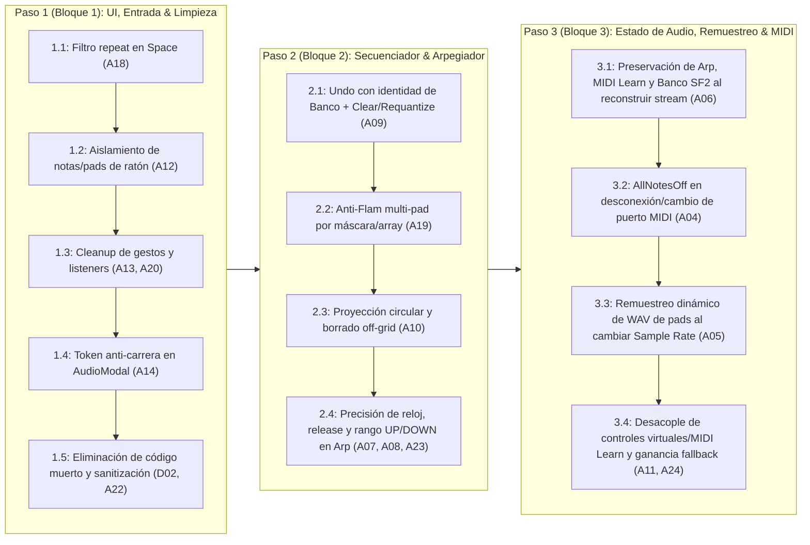

# Plan de Trabajo - Fase 9.4: Auditoría Forense de Código, Depuración Funcional & Blindaje de Estado

> **Estado:** Completada ✅  
> **Objetivo:** Ejecutar las mejoras quirúrgicas, limpiezas de código muerto confirmado y correcciones de integridad de estado derivadas de la doble auditoría estática adversarial ([`docs/INFORME_AUDITORIA_CODEX.md`](docs/INFORME_AUDITORIA_CODEX.md) y [`docs/AUDITORIA_INDEPENDIENTE_ASTRA.md`](docs/AUDITORIA_INDEPENDIENTE_ASTRA.md)), organizadas en 3 bloques incrementales de bajo riesgo y alto impacto funcional antes de iniciar la Fase 10.

---

## 1. Contexto y Conclusiones de la Doble Auditoría

Con la aplicación operando en producción en las tres plataformas (**Linux, Windows y macOS**), se realizó una auditoría en dos instancias:
1. **Primera Instancia (`INFORME_AUDITORIA_CODEX.md`):** Inventario estático de los 35 archivos de código fuente (~15,667 líneas) evaluando modularidad, posibles rutas de código muerto, concurrencia en Rust y ciclo de vida en React.
2. **Segunda Instancia Adversarial (`AUDITORIA_INDEPENDIENTE_ASTRA.md`):** Contraste forense línea por línea contra el código real que descartó falsos positivos (como `PadSampler::update_sample_rate`, que sí es invocado en `engine.rs:1508` y `1629`), demostró que el tamaño de archivo por sí mismo no degrada la latencia ni justifica divisiones masivas previas (`D01` / `O34–O40`), y descubrió hallazgos funcionales concretos (`A04` a `A24`).

### Principios Rectores de la Intervención
* **Priorizar Corrección Funcional sobre Fragmentación Cosmética:** No dividir archivos grandes (`engine.rs`, `StepSequencer.tsx`, `main.rs`) de forma prematura; aplicar primero correcciones acotadas y verificables.
* **Cero Sobre-Ingeniería en el Bucle de Audio:** Evitar reescrituras de alto riesgo de regresión en el bucle `render_internal` (como particionado sub-buffer de `rustysynth`) y concentrarse en la exactitud de estado, liberación de notas, integridad de `Undo` y preservación de configuración entre reconexiones.
* **Validación Incremental por Bloques:** Cada bloque debe compilar sin advertencias (`npm run build` + `cargo check`) y superar la suite de pruebas unitarias (`cargo test`) antes de avanzar al siguiente.

---

## 2. Arquitectura del Plan en 3 Bloques

---

## 3. Especificación Detallada de Implementación por Pasos

### Paso 1 (Bloque 1): Interacción de UI, Teclado, Ratón, Concurrencia Frontend y Limpieza ✅ [COMPLETADO]

* **Objetivo:** Erradicar interferencias entre el ratón y el controlador MIDI físico, blindar la limpieza de eventos del DOM/IPC y retirar el código muerto confirmado sin alterar el motor DSP.
* **Subpasos Técnicos:**
  1. **Subpaso 1.1 — Filtro `e.repeat` en Transporte con Barra Espaciadora (`A18` — `src/App.tsx:334-342`):**
     * Añadir `if (e.repeat) return;` al inicio del bloque `if (e.code === "Space")` en `handleKeyDown` para impedir que mantener pulsada la barra espaciadora dispare múltiples `TogglePlay` en ráfaga.
  2. **Subpaso 1.2 — Aislamiento de Propiedad de Notas y Pads Disparados por Ratón (`A12` — `src/components/HardwareSkeleton.tsx:206-225, 897-904` y `src/components/StepSequencer.tsx:1060-1063`):**
     * **Problema:** Al salir con el cursor del riel de teclas (`onMouseLeave`), se enviaba `onNoteOff` a toda tecla con `k.isActive`, cortando las notas que el músico estaba sosteniendo físicamente en el teclado MIDI o por QWERTY. Análogamente ocurría al salir de un pad en modo `Gate`.
     * **Solución:** Mantener un `useRef<Set<number>>` local (`mouseActiveNotesRef` en `HardwareSkeleton.tsx` y `mouseActivePadsRef` en `StepSequencer.tsx`) que registre únicamente las notas o pads activados por puntero/mouse y libere exclusivamente esos elementos en `onMouseLeave` / `onPointerUp` / `onPointerCancel`.
  3. **Subpaso 1.3 — Finalización Idempotente de Gestos en Controles y Cleanup de Listeners (`A13`, `A20` — `src/components/HardwareSkeleton.tsx:234-335` y `src/App.tsx:123-130, 273-356`):**
     * En `HardwareSkeleton.tsx` (faders, knobs, Pitch Bend y Mod Wheel): unificar la limpieza de `window.addEventListener` para que responda tanto a `pointerup` como a `pointercancel` y `blur`, garantizando que el Pitch Bend siempre regrese a `0` y que ningún listener quede colgado si el sistema interrumpe el gesto; además limpiar cualquier gesto activo al desmontar el componente.
     * En `App.tsx`: proteger el `useEffect` de listeners IPC con una bandera `isMounted` (ejecutando `unlisten()` inmediatamente si la promesa resuelve después del desmontaje) y limpiar ambos `setTimeout` del splash screen al desmontar.
  4. **Subpaso 1.4 — Token Anti-Condición de Carrera en Selección de Dispositivos (`A14` — `src/components/AudioSettingsModal.tsx:191-306`):**
     * Incorporar un contador de petición (`probeRequestIdRef`) en `probeDevice` y en el efecto de apertura del modal para descartar respuestas asíncronas tardías si el usuario ya cambió a otro host/dispositivo o cerró el modal.
  5. **Subpaso 1.5 — Retirada de Código Muerto Confirmado y Sanitización de Borrado SF2 (`D02`, `A22`):**
     * Eliminar el archivo sin consumidores `src/components/MidiMonitor.tsx` (preservando intactos `MidiStreamPopover.tsx` y `useMidiStream.ts`).
     * Eliminar los métodos duplicados sin llamadas en producción `AudioEngine::set_knob_mapping` y `AudioEngine::set_knob_value` (`src-tauri/src/audio/engine.rs:1975-1987`) y `PadSampler::get_gain` (`src-tauri/src/audio/sampler.rs:289-295`). *(Nota: Se preserva intacto `PadSampler::update_sample_rate`).*
     * En `delete_user_soundfont` (`src-tauri/src/soundfont/mod.rs:504-509`), validar que `filename` sea estrictamente un nombre de archivo simple (`Path::new(&filename).file_name()`) sin componentes de navegación (`..` o rutas absolutas) antes de eliminar dentro de `user_dir`.

---

### Paso 2 (Bloque 2): Exactitud Musical en Secuenciador por Pasos, Arpegiador y Enrutamiento MIDI de Pads ✅ [COMPLETADO]

* **Objetivo:** Garantizar que el historial de `Undo`, la grabación cuantizada multi-pad, el borrado de eventos con microtiming, el reloj del arpegiador y el enrutamiento MIDI de entrada de los pads físicos se comporten con exactitud matemática en todos los casos borde.
* **Subpasos Técnicos:**
  1. **Subpaso 2.1 — Historial de `Undo` Consciente del Banco Activo y Cobertura en Acciones Destructivas (`A09` — `src-tauri/src/audio/sequencer.rs:274, 419-433, 489-505, 544-548`) ✅ [COMPLETADO]:**
     * **Problema:** `undo_history` almacenaba solo `BankPattern`. Si el usuario editaba el Banco A, conmutaba al Banco B y pulsaba `UNDO`, sobrescribía el Banco B con el patrón del Banco A. Además, `clear_track`, `clear_pattern` y `requantize_pattern` no guardaban snapshot previo.
     * **Solución Implementada:** Se almacena `(PatternBank, BankPattern)` en `undo_history`. Al ejecutar `undo()`, se restaura el patrón exclusivamente sobre su banco de origen y se sincroniza `current_bank` (emitiendo `StateChanged` y `PatternUpdated`). Se incorporaron snapshots previos en `clear_track`, `clear_pattern` y `requantize_pattern` únicamente cuando existe modificación efectiva.
  2. **Subpaso 2.2 — Anti-Flam Independiente para los 8 Pads (`A19` — `src-tauri/src/audio/sequencer.rs:262-263, 528-539, 756-768`) ✅ [COMPLETADO]:**
     * **Problema:** `anti_flam_pad: Option<usize>` solo recordaba el último pad grabado en vivo. Al golpear dos pads simultáneamente (ej. Kick + Snare) con cuantización hacia adelante, el primero perdía su marca anti-flam y se redisparaba pocos milisegundos después.
     * **Solución Implementada:** Se reemplazó `anti_flam_pad` / `anti_flam_tick` por un arreglo fijo zero-alloc `anti_flam_ticks: [Option<u32>; 8]` indexado por pad (`0..8`), limpiando las marcas en `stop()`, `clear_track()`, `clear_pattern()` y `toggle_bank()`.
  3. **Subpaso 2.3 — Proyección Circular de Fin de Compás y Borrado de Eventos Off-Grid (`A10` — `src-tauri/src/audio/sequencer.rs:335-350, 435-482`) ✅ [COMPLETADO]:**
     * **Problema:** Un golpe grabado sin cuantización en el tick `383` proyectaba `step_idx = 16` en una grilla de 16 pasos (`0..15`) y quedaba invisible; además, una nota grabada en el tick `23` iluminaba la celda del paso `1` (tick nominal `24`), pero al hacer clic o arrastrar borrado sobre esa celda solo se buscaban eventos exactamente en `tick == 24`, volviendo imborrable la nota desde la UI.
     * **Solución Implementada:** Se centralizó la proyección en `StepResolution::project_tick_to_step` (`(((tick % TICKS_PER_BAR) + (ticks_per_step / 2)) / ticks_per_step) as usize % total_steps`) y se implementaron `has_projected_step` y `remove_projected_step` en `TrackEvents` para que `toggle_step` y `set_step(..., 0)` eliminen todos los eventos proyectados sobre la celda sin alterar eventos de otras celdas.
  4. **Subpaso 2.4 — Reloj Sin Deriva en Release, Liberación Segura de Voces y Rango Completo `UP/DOWN` en Arpegiador (`A07`, `A08`, `A23` — `src-tauri/src/audio/arpeggiator.rs` y `src-tauri/src/audio/engine.rs`) ✅ [COMPLETADO]:**
     * **Deriva de 1 sample (`A08`):** En `Arpeggiator::advance_sample`, se unificó el avance de reloj con `ArpOutputEvent::NoteReplace` y el incremento exacto de `samples_since_step` para mantener exactamente `samples_per_step` muestras por paso sin deriva acumulada.
     * **Liberación de voz previa (`A07`):** Cuando un nuevo paso o cambio de rate ocurre mientras `active_playing_note` sigue activa, se emite `NoteReplace { off_note, on_note, velocity }` liberando la voz anterior antes de disparar la siguiente; y al activar el arpegiador (`SetArpEnabled(true)`), se liberan las voces melódicas directas activas (`release_all_melodic_voices_on`).
     * **Secuencia `UP/DOWN` completa (`A23`):** Se ampliaron los arreglos estáticos `sequence` y `sequence_velocities` a `[u8; 96]` para alojar sin truncamiento las 94 posiciones de 16 notas × 3 octavas (100% en stack y zero-alloc).
  5. **Corrección Adelantada desde Subpaso 3.4 — Enrutamiento MIDI de Pads Físicos y MIDI Learn (`A11 parcial` — `src-tauri/src/midi/parser.rs`, `src-tauri/src/midi/mod.rs`, `src-tauri/src/main.rs`, `src/hooks/useMidiStream.ts`, `src/components/StepSequencer.tsx`) ✅ [COMPLETADO]:**
     * **Motivación (Validación Manual):** Durante la validación manual del Bloque 2 con controlador MIDI físico se detectó que los pads físicos iluminaban la UI pero no disparaban audio ni se grababan con `REC + PLAY` (y posteriormente que el Pad 1 con nota 36 quedaba excluido en canales distintos al 10).
     * **Solución Implementada:** Se unificó el mapa por defecto `DEFAULT_PAD_INPUT_NOTES = [36, 38, 42, 46, 39, 45, 48, 49]`, se sincronizó `pad_note_map: Arc<Mutex<[u8; 8]>>` en `MidiManager` de forma independiente a la nota SF2 de salida (`drum_pad_notes`), se garantizó la coherencia `NoteOn`/`NoteOff` mediante `active_note_pads: Arc<Mutex<[Option<u8>; 2048]>>` y se preservó el comportamiento histórico `Full Level (velocity 127)`.
     * **Validación Ejecutada:** Validación manual realizada con controlador MIDI físico sobre los 8 pads (disparo en vivo, asignación MIDI Learn incluyendo Pad 1 en nota 36 y grabación `REC + PLAY`) más 26 pruebas unitarias automatizadas en `cargo test`.
     * **Riesgos Residuales Conocidos al Cierre del Bloque 2:**
       1. Las notas asignadas a `pad_notes` tienen prioridad como pads en todos los canales MIDI (`1..=16`), por lo que esas 8 notas concretas disparan los pads cuando se tocan desde el teclado en el mismo puerto MIDI.
       2. Falta completar la segunda mitad de `A11` en el Subpaso 3.4: el desacople de faders y knobs virtuales arrastrados con ratón respecto al mapa de CCs de MIDI Learn (`triggerVirtualFader` / `triggerVirtualKnob`).
       3. Siguen pendientes los hallazgos del Bloque 3: preservación de estado al reconstruir el stream de audio (`A06`, `A16`), envío de `AllNotesOff` en desconexión MIDI (`A04`), remuestreo dinámico de WAV al cambiar Sample Rate (`A05`) y eliminación de ganancia duplicada en el sintetizador fallback (`A24`).

---

### Paso 3 (Bloque 3): Blindaje de Estado del Motor de Audio, Remuestreo Dinámico y MIDI ✅ [COMPLETADO]

* **Objetivo:** Asegurar que la reconstrucción del stream de audio (al abrir/cerrar ajustes o reconectar hardware) preserve el 100% del estado de la sesión, que los samples WAV mantengan su afinación a cualquier Sample Rate y que las desconexiones MIDI sean limpias.
* **Subpasos Técnicos:**
  1. **Subpaso 3.1 — Restauración Completa de Estado y Coordinación del Watchdog al Reconstruir Stream de Audio (`A06`, `A16` — `src-tauri/src/audio/engine.rs`) ✅ [COMPLETADO]:**
     * **Persistencia de Estado de Runtime (`A06`):** Preservación integral del banco y preset SF2 activo (`current_sf_bank` / `shared_bank_patch`), del arpegiador con notas retenidas en `HOLD` (`shared_arpeggiator`), de los modos y muestras de pads (`shared_pad_*`), y de las asignaciones de MIDI Learn y Mute (`shared_midi_*`), implementando una política FIFO de reconciliación determinista de comandos no aplicados previa al rebuild (`reconcile_pending_commands_before_rebuild`) inmune a colas saturadas y sin disparar notas fantasma ni colgadas.
     * **Coordinación Robusta del Watchdog y Exclusión Mutua (`A16`):** Serialización estricta de destrucciones y reconstrucciones de stream mediante `rebuild_lock` fuera del hilo de renderizado; filtrado atómico de errores tardíos de streams anteriores mediante generación monotónica (`active_stream_generation` y `report_stream_error_for_generation`); respeto absoluto de la suspensión deliberada del usuario (`user_suspended`); e inicio resiliente garantizado del watchdog con instancia única (`watchdog_spawn_count`) aun cuando el motor inicie sin DAC conectado.
     * **Validación Automatizada:** 17 pruebas unitarias específicas de A06 y A16 (totalizando 47 tests aprobados en `cargo test`) sin advertencias de compilador.
  2. **Subpaso 3.2 — Liberación Selectiva de Notas en Desconexión MIDI, Identidad de Puerto y Filtrado de Ráfagas Hardware (`A04` — `src-tauri/src/midi/mod.rs`, `src-tauri/src/audio/engine.rs`, `src-tauri/src/audio/mod.rs`, `src-tauri/src/state.rs`, `src/hooks/useMidiStream.ts`, `src/hooks/midiOwnership.ts`) ✅ [COMPLETADO]:**
     * **Comando Atómico `ReleaseNotes`:** Reemplazo de cualquier AllNotesOff global indiscriminado por una liberación selectiva (`AudioEngineCommand::ReleaseNotes { notes: [u64; 2], pads: u8 }`) que apaga única y exclusivamente las notas y pads físicos de la conexión afectada sin interrumpir notas sostenidas por el mouse/teclado virtual (respetando A12), sin detener el secuenciador y sin alterar acordes retenidos en el arpegiador con `HOLD`.
     * **Sesiones y Épocas Monotónicas (`MidiSessionGate`):** Generación monotónica `SessionEpoch` que invalida instantáneamente callbacks y eventos tardíos de conexiones previas o cambios rápidos de puerto.
     * **Normalización ALSA y Recuperación Estricta:** Función `normalize_port_name` para reconocer dispositivos físicos cuando ALSA cambia sus identificadores numéricos dinámicos (ej. `24:0` -> `28:0`), y búsqueda estricta en el watchdog para supervisar únicamente el dispositivo preferido sin reconectarse erróneamente a puertos virtuales como `Midi Through`.
     * **Filtrado de Ráfagas CC de Inicialización Hardware:** En `is_synth_melodic_cc`, restricción del reenviado al canal 0 de SoundFont exclusivamente a CCs de interpretación musical directa (Mod Wheel CC 1, Sustain CC 64, etc.), filtrando ráfagas espurias de hardware (como `CC 11 = 0` por jack de pedal de expresión vacío en el Nektar Impact LX49+ al reconectar USB) que mutaban a cero la ganancia del sintetizador melódico.
     * **Validación Automatizada:** 25 pruebas unitarias en `cargo test` y 8 pruebas unitarias en TypeScript aprobadas al 100%, más validación manual exitosa en hardware real con Nektar Impact LX49+.
  3. **Subpaso 3.3 — Preservación de Afinación y Duración de Samples WAV al Cambiar Sample Rate (`A05` — `src-tauri/src/audio/sampler.rs` y `src-tauri/src/audio/engine.rs`) ✅ [COMPLETADO]:**
     * **Reproducción Fraccionaria con Interpolación Lineal:** En `PadSampler::render_mix`, avance fraccionario `step = sample.sample_rate / engine_sample_rate` e interpolación lineal de muestras estéreo, garantizando duración y afinación exactas sin importar si el DAC opera a 44,1 kHz, 48 kHz o 96 kHz.
     * **Inmutabilidad y Cero Asignaciones:** Los buffers PCM almacenados en `PadSampleData` no se remuestrean destructivamente ni sufren degradación acumulativa al cambiar de dispositivo o reconstruir el stream de audio, operando con cero asignaciones en memoria (`zero-alloc`) y cero bloqueos (`lock-free`) en el callback de audio.
     * **Validación Automatizada:** 4 pruebas unitarias de regresión específicas de A05 en `cargo test` aprobadas al 100% (76/76 tests en total).
  4. **Subpaso 3.4 — Controles Virtuales Directos por Índice y Ganancia Fallback (`A11 restante`, `A24` — `src-tauri/src/audio/engine.rs`, `src-tauri/src/main.rs`, `src/hooks/useMidiStream.ts`) ✅ [COMPLETADO]:**
     * **Knobs y Faders Virtuales Desacoplados (`A11 restante`):** En `useMidiStream.ts`, `triggerVirtualFader` y `triggerVirtualKnob` invocan directamente los comandos IPC por índice (`set_pad_slot_gain`, `set_master_volume`, `set_knob_value`) con escala normalizada $[0, 1]$, eliminando la emisión artificial de CCs. Los controles de ratón operan de forma 100% independiente de las asignaciones de MIDI Learn del hardware.
     * **Eliminación de Doble Ganancia Master (`A24`):** En `AudioRenderState::next_sample()`, se retiró la multiplicación redundante por `self.master_gain`. La ruta fallback aplica la atenuación master de manera uniforme y lineal en la etapa de salida (`render_f32`/`i16`/`u16`), idéntico al comportamiento del SoundFont y Custom WAV.
     * **Validación Automatizada:** Nuevas pruebas unitarias de regresión en Rust (`test_a11_virtual_controls_independent_from_midi_learn_and_physical_mappings` y `test_a24_fallback_synth_master_gain_applied_linearly_once`) y en TypeScript aprobadas al 100% (79 tests Rust, 9 tests TS).

---

## 4. Criterios de Aceptación y Cierre de la Fase 9.4 ✅ [CUMPLIDOS AL 100%]

1. **Compilación Limpia:** `npm run build` y `cargo check --manifest-path src-tauri/Cargo.toml` finalizan con código `0` y sin advertencias nuevas.
2. **Suite de Tests Automatizados:** `cargo test --manifest-path src-tauri/Cargo.toml` pasa al 100% (79/79 pruebas aprobadas) y `node --experimental-strip-types --test tests/midiOwnership.test.ts` (9/9 pruebas aprobadas), cubriendo exhaustivamente:
   * `Undo` entre Bancos A y B y después de `clear_pattern` / `requantize_pattern`.
   * Anti-flam simultáneo en múltiples pads independientes.
   * Borrado de pasos off-grid y proyección circular del tick `383`.
   * Reloj de arpegiador sin deriva de 1 muestra en `NoteRelease` y secuencia `UP/DOWN` extendida a 96 pasos.
   * Reproducción fraccionaria e interpolación lineal de `PadSampleData` al cambiar entre 44.1 kHz, 48 kHz y 96 kHz.
   * Coordinación del watchdog de audio y exclusión mutua sin reconstrucciones duplicadas.
   * Liberación selectiva de notas (`ReleaseNotes`), filtrado de ráfagas CC melódicas y aislamiento de controles virtuales.
3. **Auditorías Finales de Integración Adversarial (F1, F2, F3 y F4) Aprobadas:**
   * **Auditoría F1 (Seguridad RT y reconstrucción):** Verificación sin asignaciones dinámicas en el callback de audio, exclusión mutua de rebuild serializada y sin condiciones de carrera.
   * **Auditoría F2 (Integración MIDI, ownership y controles):** Verificación de ownership de notas virtuales/físicas, épocas monotónicas de sesión, reconexión limpia y desacople de MIDI Learn.
   * **Auditoría F3 (Integración de audio: SF2, Custom WAV y procesamiento):** Verificación de ganancia master aplicada una sola vez (lineal), preservación de afinación fraccionaria WAV y coherencia de transporte.
   * **Auditoría F4 (Higiene de código y validación global):** Verificación de cero dead code residual, cero warnings y árbol Git limpio con 7 commits atómicos.
4. **Cierre Definitivo:** Fase 9.4 cerrada formalmente con todos los objetivos funcionales y de blindaje completados, lista para el inicio de la Fase 10.
