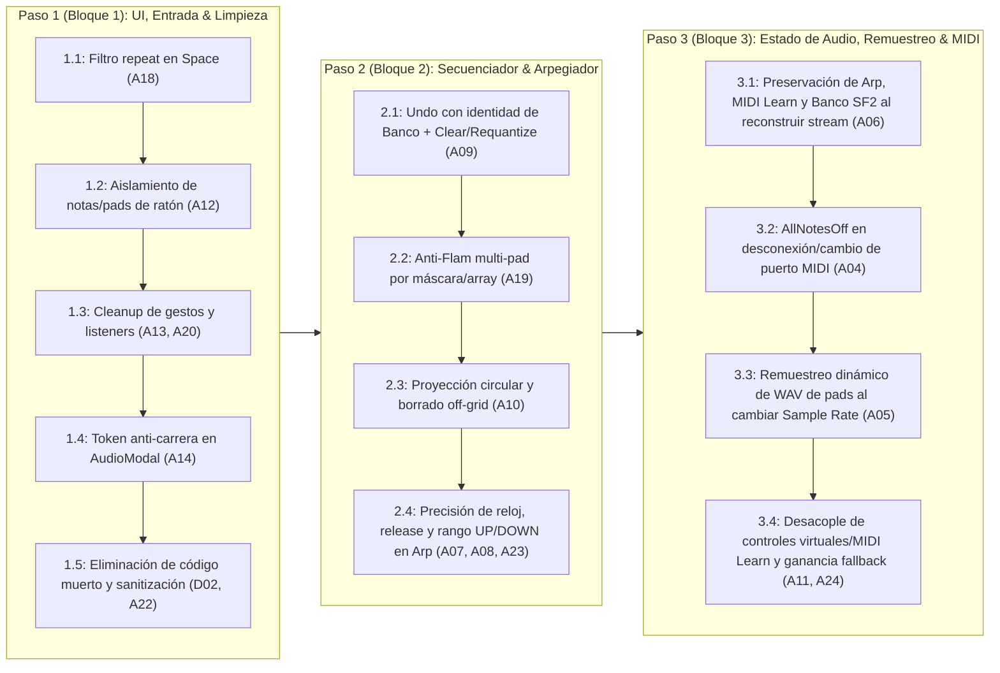

# Plan de Trabajo - Fase 9.4: Auditoría Forense de Código, Depuración Funcional & Blindaje de Estado

> **Estado:** En Progreso 🚧  
> **Objetivo:** Ejecutar las mejoras quirúrgicas, limpiezas de código muerto confirmado y correcciones de integridad de estado derivadas de la doble auditoría estática adversarial ([`docs/INFORME_AUDITORIA_CODEX.md`](docs/INFORME_AUDITORIA_CODEX.md) y [`docs/AUDITORIA_INDEPENDIENTE_ASTRA.md`](docs/AUDITORIA_INDEPENDIENTE_ASTRA.md)), organizadas en 3 bloques incrementales de bajo riesgo y alto impacto funcional antes de iniciar la Fase 10.

---

## 1. Contexto y Conclusiones de la Doble Auditoría

Con la aplicación operando en producción en las tres plataformas (**Linux, Windows y macOS**), se realizó una auditoría en dos instancias:
1. **Primera Instancia (`INFORME_AUDITORIA_CODEX.md`):** Inventario estático de los 35 archivos de código fuente (~15,667 líneas) evaluando modularidad, posibles rutas de código muerto, concurrencia en Rust y ciclo de vida en React.
2. **Segunda Instancia Adversarial (`AUDITORIA_INDEPENDIENTE_ASTRA.md`):** Contraste forense línea por línea contra el código real que descartó falsos positivos (como `PadSampler::update_sample_rate`, que sí es invocado en `engine.rs:1508` y `1629`), demostró que el tamaño de archivo por sí mismo no degrada la latencia ni justifica divisiones masivas previas (`D01` / `O34–O40`), y descubrió hallazgos funcionales concretos (`A04` a `A24`).

### Principios Rectores de la Intervención
* **Priorizar Corrección Funcional sobre Fragmentación Cosmética:** No dividir archivos grandes (`engine.rs`, `StepSequencer.tsx`, `main.rs`) de forma prematura; aplicar primero correcciones acotadas y verificables.
* **Cero Sobre-Ingeniería en el Bucle de Audio:** Evitar reescrituras de alto riesgo de regresión en el bucle `render_internal` (como particionado sub-buffer de `rustysynth`) y concentrarse en la exactitud de estado, liberación de notas, integridad de `Undo` y preservación de configuración entre reconexiones.
* **Validación Incremental por Bloques:** Cada bloque debe compilar sin advertencias (`npm run build` + `cargo check`) y superar la suite de pruebas unitarias (`cargo test`) antes de avanzar al siguiente.

---

## 2. Arquitectura del Plan en 3 Bloques

---

## 3. Especificación Detallada de Implementación por Pasos

### Paso 1 (Bloque 1): Interacción de UI, Teclado, Ratón, Concurrencia Frontend y Limpieza ✅ [COMPLETADO]

* **Objetivo:** Erradicar interferencias entre el ratón y el controlador MIDI físico, blindar la limpieza de eventos del DOM/IPC y retirar el código muerto confirmado sin alterar el motor DSP.
* **Subpasos Técnicos:**
  1. **Subpaso 1.1 — Filtro `e.repeat` en Transporte con Barra Espaciadora (`A18` — `src/App.tsx:334-342`):**
     * Añadir `if (e.repeat) return;` al inicio del bloque `if (e.code === "Space")` en `handleKeyDown` para impedir que mantener pulsada la barra espaciadora dispare múltiples `TogglePlay` en ráfaga.
  2. **Subpaso 1.2 — Aislamiento de Propiedad de Notas y Pads Disparados por Ratón (`A12` — `src/components/HardwareSkeleton.tsx:206-225, 897-904` y `src/components/StepSequencer.tsx:1060-1063`):**
     * **Problema:** Al salir con el cursor del riel de teclas (`onMouseLeave`), se enviaba `onNoteOff` a toda tecla con `k.isActive`, cortando las notas que el músico estaba sosteniendo físicamente en el teclado MIDI o por QWERTY. Análogamente ocurría al salir de un pad en modo `Gate`.
     * **Solución:** Mantener un `useRef<Set<number>>` local (`mouseActiveNotesRef` en `HardwareSkeleton.tsx` y `mouseActivePadsRef` en `StepSequencer.tsx`) que registre únicamente las notas o pads activados por puntero/mouse y libere exclusivamente esos elementos en `onMouseLeave` / `onPointerUp` / `onPointerCancel`.
  3. **Subpaso 1.3 — Finalización Idempotente de Gestos en Controles y Cleanup de Listeners (`A13`, `A20` — `src/components/HardwareSkeleton.tsx:234-335` y `src/App.tsx:123-130, 273-356`):**
     * En `HardwareSkeleton.tsx` (faders, knobs, Pitch Bend y Mod Wheel): unificar la limpieza de `window.addEventListener` para que responda tanto a `pointerup` como a `pointercancel` y `blur`, garantizando que el Pitch Bend siempre regrese a `0` y que ningún listener quede colgado si el sistema interrumpe el gesto; además limpiar cualquier gesto activo al desmontar el componente.
     * En `App.tsx`: proteger el `useEffect` de listeners IPC con una bandera `isMounted` (ejecutando `unlisten()` inmediatamente si la promesa resuelve después del desmontaje) y limpiar ambos `setTimeout` del splash screen al desmontar.
  4. **Subpaso 1.4 — Token Anti-Condición de Carrera en Selección de Dispositivos (`A14` — `src/components/AudioSettingsModal.tsx:191-306`):**
     * Incorporar un contador de petición (`probeRequestIdRef`) en `probeDevice` y en el efecto de apertura del modal para descartar respuestas asíncronas tardías si el usuario ya cambió a otro host/dispositivo o cerró el modal.
  5. **Subpaso 1.5 — Retirada de Código Muerto Confirmado y Sanitización de Borrado SF2 (`D02`, `A22`):**
     * Eliminar el archivo sin consumidores `src/components/MidiMonitor.tsx` (preservando intactos `MidiStreamPopover.tsx` y `useMidiStream.ts`).
     * Eliminar los métodos duplicados sin llamadas en producción `AudioEngine::set_knob_mapping` y `AudioEngine::set_knob_value` (`src-tauri/src/audio/engine.rs:1975-1987`) y `PadSampler::get_gain` (`src-tauri/src/audio/sampler.rs:289-295`). *(Nota: Se preserva intacto `PadSampler::update_sample_rate`).*
     * En `delete_user_soundfont` (`src-tauri/src/soundfont/mod.rs:504-509`), validar que `filename` sea estrictamente un nombre de archivo simple (`Path::new(&filename).file_name()`) sin componentes de navegación (`..` o rutas absolutas) antes de eliminar dentro de `user_dir`.

---

### Paso 2 (Bloque 2): Exactitud Musical en Secuenciador por Pasos y Arpegiador ⏳ [PENDIENTE]

* **Objetivo:** Garantizar que el historial de `Undo`, la grabación cuantizada multi-pad, el borrado de eventos con microtiming y el reloj del arpegiador se comporten con exactitud matemática en todos los casos borde.
* **Subpasos Técnicos:**
  1. **Subpaso 2.1 — Historial de `Undo` Consciente del Banco Activo y Cobertura en Acciones Destructivas (`A09` — `src-tauri/src/audio/sequencer.rs:274, 419-433, 489-505, 544-548`):**
     * **Problema:** `undo_history` almacenaba solo `BankPattern`. Si el usuario editaba el Banco A, conmutaba al Banco B y pulsaba `UNDO`, sobrescribía el Banco B con el patrón del Banco A. Además, `clear_track`, `clear_pattern` y `requantize_pattern` no guardaban snapshot previo.
     * **Solución:** Almacenar `(PatternBank, BankPattern)` en `undo_history`. Al ejecutar `undo()`, restaurar el patrón sobre su banco correspondiente (y sincronizar `active_bank` a dicho banco para que el usuario vea el resultado restaurado). Invocar `save_undo_state()` al inicio de `clear_track`, `clear_pattern` (solo si había algún paso activo) y `requantize_pattern`.
  2. **Subpaso 2.2 — Anti-Flam Independiente para los 8 Pads (`A19` — `src-tauri/src/audio/sequencer.rs:262-263, 528-539, 756-768`):**
     * **Problema:** `anti_flam_pad: Option<usize>` solo recordaba el último pad grabado en vivo. Al golpear dos pads simultáneamente (ej. Kick + Snare) con cuantización hacia adelante, el primero perdía su marca anti-flam y se redisparaba pocos milisegundos después.
     * **Solución:** Reemplazar `anti_flam_pad` / `anti_flam_tick` por un arreglo fijo zero-alloc `anti_flam_ticks: [Option<u32>; 8]` indexado por pad (`0..8`).
  3. **Subpaso 2.3 — Proyección Circular de Fin de Compás y Borrado de Eventos Off-Grid (`A10` — `src-tauri/src/audio/sequencer.rs:335-350, 435-482`):**
     * **Problema:** Un golpe grabado sin cuantización en el tick `383` proyectaba `step_idx = 16` en una grilla de 16 pasos (`0..15`) y quedaba invisible; además, una nota grabada en el tick `23` iluminaba la celda del paso `1` (tick nominal `24`), pero al hacer clic o arrastrar borrado sobre esa celda solo se buscaban eventos exactamente en `tick == 24`, volviendo imborrable la nota desde la UI.
     * **Solución:** Unificar la función de proyección de tick a paso con módulo circular (`((tick + ticks_per_step / 2) / ticks_per_step) as usize % total_steps`) tanto al construir la vista `get_active_pattern` como al eliminar eventos en `toggle_step` y `set_step(..., false)`, de modo que apagar una celda limpie todos los eventos cuyos ticks proyecten sobre esa celda.
  4. **Subpaso 2.4 — Reloj Sin Deriva en Release, Liberación Segura de Voces y Rango Completo `UP/DOWN` en Arpegiador (`A07`, `A08`, `A23` — `src-tauri/src/audio/arpeggiator.rs` y `src-tauri/src/audio/engine.rs`):**
     * **Deriva de 1 sample (`A08`):** En `Arpeggiator::advance_sample` (`arpeggiator.rs:338-356`), incrementar `self.samples_since_step += 1` antes de retornar `ArpEvent::NoteRelease(note)` para que el ciclo mantenga exactamente `samples_per_step` muestras por paso.
     * **Liberación de voz previa (`A07`):** Si `advance_sample` alcanza un nuevo paso mientras `active_playing_note` sigue en `Some(prev_note)` (por ejemplo, tras cambiar el rate de `1/4` a `1/32` a mitad de una nota larga), emitir o liberar la nota previa antes de disparar la nueva; y al activar el arpegiador (`set_arp_enabled(true)`), cortar notas melódicas directas previas para que no queden sostenidas sin `NoteOff`.
     * **Secuencia `UP/DOWN` completa (`A23`):** Ampliar la capacidad del arreglo estático `sequence: [u8; 96]` en `arpeggiator.rs` para alojar sin truncamiento la subida y bajada completa de hasta 16 notas × 3 octavas (48 de subida + 46 de bajada = 94 pasos, 100% en stack y zero-alloc).

---

### Paso 3 (Bloque 3): Blindaje de Estado del Motor de Audio, Remuestreo Dinámico y MIDI ⏳ [PENDIENTE]

* **Objetivo:** Asegurar que la reconstrucción del stream de audio (al abrir/cerrar ajustes o reconectar hardware) preserve el 100% del estado de la sesión, que los samples WAV mantengan su afinación a cualquier Sample Rate y que las desconexiones MIDI sean limpias.
* **Subpasos Técnicos:**
  1. **Subpaso 3.1 — Restauración Completa de Estado al Reconstruir Stream de Audio (`A06`, `A16` — `src-tauri/src/audio/engine.rs:418-473, 1510-1517, 1631-1637`):**
     * Guardar en `AudioEngine` el banco SF2 activo (`current_sf_bank: Arc<Mutex<i32>>`), los mapeos de MIDI Learn activos y sincronizar `shared_arpeggiator` cuando cambian los parámetros del arpegiador.
     * Al inicializar `AudioRenderState::new` y reconstruir el sintetizador en CPAL/ASIO, restaurar el `Arpeggiator` desde `shared_arpeggiator`, los CCs de MIDI Learn configurados y el par `(bank, preset)` real del SoundFont activo (en lugar de forzar `bank = 0`).
     * Limpiar `device_invalidated` al aplicar manualmente una configuración de audio exitosa y asegurar que `spawn_watchdog` se inicie siempre aunque el arranque inicial no encuentre un DAC disponible (`A16`).
  2. **Subpaso 3.2 — Envío de `AllNotesOff` en Desconexión o Cambio de Puerto MIDI (`A04` — `src-tauri/src/midi/mod.rs:93-97, 128-136, 362-376` y `src/hooks/useMidiStream.ts`):**
     * Cuando el watchdog MIDI detecta desconexión física del controlador o el usuario cambia/desconecta el puerto MIDI, encolar `AudioEngineCommand::AllNotesOff` hacia el motor de audio y limpiar el mapa de notas/pads activos en `useMidiStream.ts` para evitar notas colgadas.
  3. **Subpaso 3.3 — Preservación de Afinación y Duración de Samples WAV al Cambiar Sample Rate (`A05` — `src-tauri/src/audio/sampler.rs` y `src-tauri/src/audio/engine.rs`):**
     * Conservar en `SampleData` los frames PCM originales y su `source_sample_rate` nativo (o remuestrear desde la fuente original cuando `AudioEngine` construye un stream a una nueva frecuencia de muestreo como 44.1 kHz, 48 kHz o 96 kHz), garantizando que tanto el kit de fábrica como los WAV cargados por el usuario suenen siempre con la velocidad y afinación exactas.
  4. **Subpaso 3.4 — Controles Virtuales Directos por Índice, Mapeo de Pads y Ganancia Fallback (`A11`, `A24` — `src-tauri/src/midi/parser.rs`, `src-tauri/src/audio/engine.rs`, `src/hooks/useMidiStream.ts`):**
     * **Knobs y Faders Virtuales (`A11`):** Hacer que arrastrar con el mouse un fader o knob en la UI actualice directamente el índice del fader (`0..8`) o knob (`0..7`) sin pasar por la tabla de búsqueda de CCs de MIDI Learn, evitando que reasignar un CC físico desvíe el control del mouse hacia otra perilla.
     * **MIDI Learn de Pads (`A11`):** Permitir que las notas aprendidas para los pads (`pad_notes`) sean reconocidas por el despachador de entrada MIDI para disparar el pad correspondiente sin sobrescribir la nota GM del kit de batería SF2.
     * **Ganancia de Sintetizador Fallback (`A24`):** Eliminar la multiplicación duplicada por `master_gain` en `engine.rs:1145` (ya que `master_gain` se aplica en la etapa de salida final en `1338-1356`).

---

## 4. Criterios de Aceptación y Cierre de la Fase 9.4

1. **Compilación Limpia:** `npm run build` y `cargo check --manifest-path src-tauri/Cargo.toml` finalizan con código `0` y sin advertencias nuevas.
2. **Suite de Tests Automatizados:** `cargo test --manifest-path src-tauri/Cargo.toml` pasa al 100%, incluyendo nuevos tests unitarios para:
   * `Undo` entre Bancos A y B y después de `clear_pattern` / `requantize_pattern`.
   * Anti-flam simultáneo en múltiples pads.
   * Borrado de pasos off-grid y proyección circular del tick `383`.
   * Reloj de arpegiador sin deriva de 1 muestra en `NoteRelease` y secuencia `UP/DOWN` extendida.
   * Re-muestreo de `SampleData` al cambiar entre 44.1 kHz, 48 kHz y 96 kHz.
3. **Actualización en Producción Local:** Binario actualizado con `npm run build:bin` e instalado en `/usr/bin/impact_sampler`.
