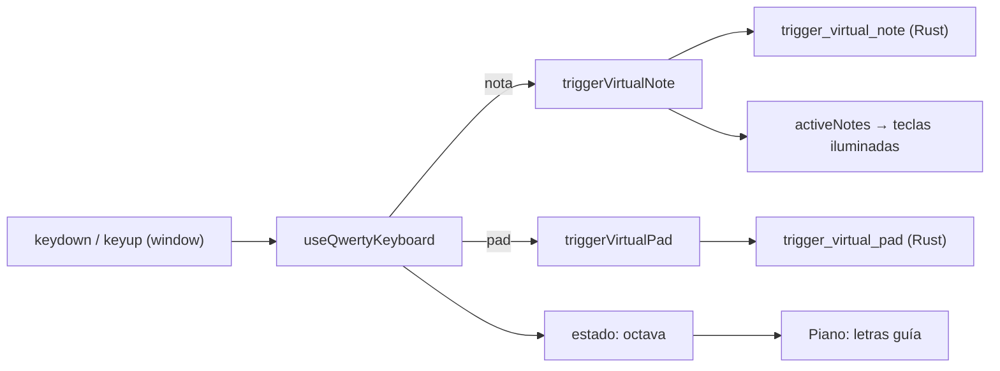

# Fase 7 · Teclado QWERTY — Plan de implementación

> Estado: **COMPLETADO ✅**. Implementación finalizada y verificada en hardware/software.

## 1. Hallazgos del código actual

| Tema | Hallazgo | Implicación |
|---|---|---|
| Notas virtuales | [useMidiStream.ts](file:///C:/Users/WLADI/Documents/ImpactSamplerStudio/src/hooks/useMidiStream.ts#L400-L415) expone `triggerVirtualNote(note, velocity 0-127, isOn)`. Actualiza `activeNotes` (React) e invoca `trigger_virtual_note`. | El teclado virtual ya se ilumina por `activeNotes`. QWERTY puede reutilizar `triggerVirtualNote` y obtener la animación 1:1 sin código nuevo de UI. |
| Pads virtuales | `triggerVirtualPad(padIdx 1-8, _, isOn)` envía `trigger_virtual_pad`, con velocity fija 127 ([L417-433](file:///C:/Users/WLADI/Documents/ImpactSamplerStudio/src/hooks/useMidiStream.ts#L417-L433)). | Los pads QWERTY pueden reutilizarlo. Graban en overdub porque `PadTrigger` ya alimenta el secuenciador cuando `is_recording`. |
| Rango del teclado | 49 teclas, notas **36 (C1) a 84 (C5)** ([HardwareSkeleton.tsx L153-159](file:///C:/Users/WLADI/Documents/ImpactSamplerStudio/src/components/HardwareSkeleton.tsx#L153-L159)). El Mellotron limita a **43–77** vía `keyRange` ([App.tsx L851-855](file:///C:/Users/WLADI/Documents/ImpactSamplerStudio/src/App.tsx#L851-L855)). | El hook debe recibir `keyRange` y filtrar notas fuera de rango (decisión Q4). |
| Modo SEQ | En `workstationMode === "seq"` el teclado se oculta (`hideKeyboard`). | Hay que decidir qué hace QWERTY en SEQ (Q2). |
| Atajo existente | [App.tsx L271-281](file:///C:/Users/WLADI/Documents/ImpactSamplerStudio/src/App.tsx#L271-L281): `Space` → `sequencer_toggle_play`. Solo se excluye `HTMLInputElement` y `HTMLTextAreaElement`. | `Space` no choca con ninguna tecla musical. El filtro actual es incompleto (no cubre `select`, `contenteditable` ni modales). |
| Otros `keydown` | `Escape` en Header, modales, HardwareSkeleton, StepSequencer y MidiStreamPopover. `ArrowLeft`/`ArrowRight` en `InstrumentSelectModal`. | No chocan con las letras. Conviene que QWERTY no capture teclas con `ctrl`, `alt` ni `meta`. |
| Comandos Tauri | `invoke` por cada nota. Cada `trigger_virtual_note` bloquea un `Mutex` del producer y emite un evento `midi-event`. | Es suficiente para uso humano. Puede haber latencia y overhead al tocar acordes. Ver riesgos. |
| Notas de pad en el parser | `parser.rs` mapea las notas 36–43 a Pads 1–8 por regla de canal, no por nota. | Una nota QWERTY en 36–43 podría activar un pad en el monitor. Revisar en la implementación. |
| Feedback UI | `activeNotes` es `Map<number, number>` y se actualiza con `new Map` en cada evento. | Funciona. Con muchas teclas simultáneas habrá re-renders, pero el volumen es bajo. |

## 2. Arquitectura propuesta



**Decisión de diseño:** el cambio es **100% frontend**. Se reutilizan los comandos Rust existentes y no se toca el hilo de audio.

### Hook `useQwertyKeyboard`
- Archivo nuevo: `src/hooks/useQwertyKeyboard.ts`.
- Parámetros: `enabled`, `keyRange`, `workstationMode`, `triggerNote`, `releaseNote`, `triggerPad`, `releasePad`.
- Estado interno: `octaveOffset` (−3..+3) y un `Map<code, acción disparada>` de teclas físicas activas.
- Velocity fija en **127**.
- Usa **`event.code`** y no `event.key`, para que funcione igual en cualquier distribución (AZERTY, etc.).
- Ignora `event.repeat`, `ctrlKey`, `altKey` y `metaKey`.
- Ignora el evento si el foco está en un `input`, `textarea`, `select` o `[contenteditable]`.
- **Guarda la nota o el pad realmente disparado por cada `code` al hacer `keydown`.** El `keyup` libera esa nota y no recalcula con la octava actual. Así un cambio de octava con teclas apretadas no deja notas colgadas.
- Libera todas las notas y pads activos en estos casos:
  - `window.blur`
  - desactivación del modo QWERTY
  - cambio de modo `keys` ↔ `seq`
- En modo `SEQ` se ignoran las letras de nota y solo responden los pads `1–8`.
- Las notas fuera de `keyRange` (Mellotron 43–77) se ignoran.
- No toca `Space`: sigue manejado por el atajo existente de `App.tsx`.

### Mapa de teclas

```
 Negras:     W  E     T  Y  U     O  P
 Blancas:   A  S  D  F  G  H  J  K  L  ;
 Nota:      C  D  E  F  G  A  B  C  D  E

 Pads:      1  2  3  4  5  6  7  8   → Pad 1 … Pad 8
 Octava:    Z (−1)   X (+1)
```
- Octava base por defecto: C3 (nota 60), dentro del rango de 49 teclas y del Mellotron.
- Los pads (`1–8`) funcionan en modo `keys` y en modo `seq`, siempre con QWERTY activo.

## 3. Archivos a modificar

| Archivo | Cambio |
|---|---|
| `src/hooks/useQwertyKeyboard.ts` (nuevo) | Hook descrito arriba, más el mapa de teclas como constante exportada. |
| [App.tsx](file:///C:/Users/WLADI/Documents/ImpactSamplerStudio/src/App.tsx) | Estado `qwertyEnabled` (default `false`, sin persistencia). Montar el hook. Pasar `qwertyEnabled` y `octave` al Header y a `HardwareSkeleton`. **El atajo `Space` no se modifica.** |
| [Header.tsx](file:///C:/Users/WLADI/Documents/ImpactSamplerStudio/src/components/Header.tsx) | Botón toggle `QWERTY` con LED esmeralda y tooltip breve. Sin indicadores adicionales. |
| [HardwareSkeleton.tsx](file:///C:/Users/WLADI/Documents/ImpactSamplerStudio/src/components/HardwareSkeleton.tsx) | Prop opcional `qwertyLabels: Map<note, string>`. Dibuja la letra serigrafiada sobre las teclas del rango activo, sutil y sin afectar el layout. Como las letras se desplazan con la octava, también muestran la octava activa. |
| [PLAN_DE_TRABAJO.md](file:///C:/Users/WLADI/Documents/ImpactSamplerStudio/PLAN_DE_TRABAJO.md) | Marcar Fase 7 como completada y documentar el mapa final (sin velocity ajustable). |

No se modifica Rust.

## 4. Pasos de implementación

Cada paso es compilable y verificable por separado. Se recomienda ejecutar `npm run build` (o `npx tsc --noEmit`) al cerrar cada uno.

### Paso 1 · Constantes y hook `useQwertyKeyboard`
**Archivo nuevo:** `src/hooks/useQwertyKeyboard.ts`

1. Exportar las constantes del mapa de teclas, indexadas por `event.code`:
   - `QWERTY_NOTE_OFFSETS`: `KeyA:0, KeyW:1, KeyS:2, KeyE:3, KeyD:4, KeyF:5, KeyT:6, KeyG:7, KeyY:8, KeyH:9, KeyU:10, KeyJ:11, KeyK:12, KeyO:13, KeyL:14, KeyP:15, Semicolon:16`.
   - `QWERTY_PAD_CODES`: `Digit1 … Digit8` → pad `1 … 8`.
   - `QWERTY_OCTAVE_DOWN = "KeyZ"` y `QWERTY_OCTAVE_UP = "KeyX"`.
   - `QWERTY_BASE_NOTE = 60` (C3) y `QWERTY_VELOCITY = 127`.
2. Firma del hook:
   ```ts
   useQwertyKeyboard({
     enabled: boolean,
     workstationMode: "keys" | "seq",
     keyRange?: { minNote: number; maxNote: number },
     onNoteOn: (note: number, velocity: number) => void,
     onNoteOff: (note: number) => void,
     onPadOn: (padIdx: number) => void,   // 1..8
     onPadOff: (padIdx: number) => void,  // 1..8
   }): { octaveOffset: number; baseNote: number }
   ```
3. Estado: `octaveOffset` (límite −2..+2) en un `useState`. `activeRef = useRef<Map<string, { type: "note" | "pad"; value: number }>>`.
4. `keydown`:
   - Salir si `!enabled`, `e.repeat`, `e.ctrlKey || e.altKey || e.metaKey`.
   - Salir si `e.target` es `HTMLInputElement`, `HTMLTextAreaElement`, `HTMLSelectElement` o `isContentEditable`.
   - Si el `code` ya está en `activeRef`, salir (evita doble disparo).
   - `Z`/`X`: ajustar `octaveOffset` con límites y salir. No suenan.
   - Pad (`Digit1..8`): disparar `onPadOn(n)` y guardar `{type:"pad", value:n}`. Funciona en `keys` y en `seq`.
   - Nota (solo si `workstationMode === "keys"`): `note = 60 + octaveOffset*12 + offset`. Ignorar si está fuera de `keyRange` o de 0..127. Disparar `onNoteOn(note, 127)` y guardar `{type:"note", value:note}`.
   - Llamar `e.preventDefault()` solo cuando la tecla fue consumida. **Nunca** para `Space` ni para teclas no mapeadas.
5. `keyup`: buscar el `code` en `activeRef`. Si existe, liberar con **la nota o pad guardado** (no recalcular con la octava actual) y borrarlo del mapa.
6. `releaseAll()`: recorrer `activeRef`, liberar todo y limpiar. Se invoca desde:
   - `window` `blur`.
   - Un `useEffect` cuando `enabled` pasa a `false`.
   - Un `useEffect` cuando cambia `workstationMode`.
   - El cleanup del efecto principal (desmontaje).
7. Registrar los listeners con `window.addEventListener("keydown"/"keyup")` dentro de un `useEffect` con las dependencias necesarias. Las funciones `onNoteOn` y demás se leen vía `useRef` para evitar re-registrar listeners en cada render.

**Criterio de cierre:** el archivo compila sin errores de tipos y no se usa todavía.

---

### Paso 2 · Integración en `App.tsx`
**Archivo:** [App.tsx](file:///C:/Users/WLADI/Documents/ImpactSamplerStudio/src/App.tsx)

1. Crear `const [qwertyEnabled, setQwertyEnabled] = useState(false);` (sin persistencia, Q9).
2. Calcular `keyRange` una sola vez (hoy es un literal inline en el JSX, [L851-855](file:///C:/Users/WLADI/Documents/ImpactSamplerStudio/src/App.tsx#L851-L855)): `const keyRange = isMellotron ? { minNote: 43, maxNote: 77, label: "G2 a F5" } : undefined;`. Reutilizarlo en el hook y en `HardwareSkeleton`.
3. Montar el hook:
   ```ts
   const { octaveOffset } = useQwertyKeyboard({
     enabled: qwertyEnabled,
     workstationMode,
     keyRange,
     onNoteOn: (note, vel) => triggerVirtualNote(note, vel, true),
     onNoteOff: (note) => triggerVirtualNote(note, 0, false),
     onPadOn: (p) => triggerVirtualPad(p, 0, true),
     onPadOff: (p) => triggerVirtualPad(p, 0, false),
   });
   ```
4. Pasar a `Header`: `qwertyEnabled` y `onToggleQwerty={() => setQwertyEnabled(v => !v)}`.
5. Pasar a `HardwareSkeleton`: `qwertyEnabled` y `qwertyOctaveOffset={octaveOffset}`.
6. **No modificar** el `handleKeyDown` de `Space` ([L271-281](file:///C:/Users/WLADI/Documents/ImpactSamplerStudio/src/App.tsx#L271-L281)).

**Criterio de cierre:** compila. Con el toggle forzado a `true` desde el código (prueba temporal), `A S D F…` suenan y `1–8` disparan pads. Quitar la prueba temporal antes de seguir.

---

### Paso 3 · Botón toggle en el Header
**Archivo:** [Header.tsx](file:///C:/Users/WLADI/Documents/ImpactSamplerStudio/src/components/Header.tsx)

1. Agregar props `qwertyEnabled: boolean` y `onToggleQwerty: () => void`.
2. Añadir el botón `QWERTY` junto a `MIDI LEARN`, estilizado como botón compacto con icono de teclado de computadora (`Keyboard` de `lucide-react`) y respuesta visual Noir-Tech:
   - **OFF:** Icono en grafito (`text-zinc-400`) sobre chasis oscuro (`border-white/[0.08]`).
   - **ON:** Icono en verde esmeralda neón (`text-emerald-400 drop-shadow-[0_0_6px_rgba(52,211,153,0.8)]`) con fondo y borde reactivo (`border-emerald-500/50 bg-emerald-500/20`).
3. `title`: `Teclado de computadora QWERTY (ON/OFF)`.
4. Quitar el foco tras el clic (`e.currentTarget.blur()`), para que `Space` no vuelva a activar el botón y mantenga su función exclusiva de transporte.

**Criterio de cierre:** el botón alterna el estado y el icono iluminado. Cero desplazamientos en el Header.

---

### Paso 4 · Letras guía sobre el piano
**Archivo:** [HardwareSkeleton.tsx](file:///C:/Users/WLADI/Documents/ImpactSamplerStudio/src/components/HardwareSkeleton.tsx)

1. Agregar props `qwertyEnabled?: boolean` y `qwertyOctaveOffset?: number`.
2. Calcular un `Map<number, string>` con `useMemo`: `nota → letra` usando `QWERTY_NOTE_OFFSETS` y `QWERTY_BASE_NOTE + octaveOffset*12`. Para `Semicolon` mostrar `;`. Excluir notas fuera de `keyRange`.
3. En el render de las 49 teclas (generadas en [L153-166](file:///C:/Users/WLADI/Documents/ImpactSamplerStudio/src/components/HardwareSkeleton.tsx#L153-L166)), si `qwertyEnabled` y la nota tiene letra, mostrar una etiqueta pequeña y de baja opacidad:
   - Posición absoluta en la parte inferior de la tecla.
   - `pointer-events-none` y `select-none`.
   - No debe alterar alto, ancho ni el comportamiento del glissando.
4. Mostrar también el número `1–8` sobre los pads cuando QWERTY esté activo, solo si no obliga a cambiar el layout. Si no cabe, omitirlo y dejarlo como mejora opcional.

**Criterio de cierre:** al activar QWERTY aparecen las letras y se desplazan al pulsar `Z`/`X`. Al desactivarlo desaparecen. No hay saltos de layout (ver Fase 5.1).

---

### Paso 5 · Pruebas manuales y regresión
Ejecutar completa la sección 5. En particular verificar:
- Sin controlador conectado: tocar con Piano, Rhodes y Mellotron.
- Con el Nektar conectado: los dos orígenes a la vez.
- `Space` con y sin QWERTY, y con el botón del Header recién pulsado.
- Pads `1–8` en `WAV SAMPLER`, `DRUM SF2` y `MIRROR`, y en vistas `keys` y `seq`.
- Grabación Overdub con pads por QWERTY.
- Notas colgadas: cambio de octava con tecla pulsada, `Alt+Tab`, apagar QWERTY, cambiar `keys`↔`seq` y abrir un modal.

**Criterio de cierre:** todos los ítems de la sección 5 marcados.

---

### Paso 6 · Documentación
**Archivo:** [PLAN_DE_TRABAJO.md](file:///C:/Users/WLADI/Documents/ImpactSamplerStudio/PLAN_DE_TRABAJO.md)

1. Marcar la Fase 7 como `✅ [COMPLETADA]`, actualizar el nodo del diagrama si corresponde, y enlazar a este documento.
2. Reescribir la descripción de la Fase 7 con el diseño final:
   - Velocity fija en 127 (no hay `C`/`V`).
   - Pads en `1–8`.
   - Sin indicador de octava (las letras guía lo muestran).
   - Sin persistencia.
3. Actualizar la sección «Próximo Paso Inmediato»: Fases 1 a 7 completadas, siguiente hito **Fase 8**.
4. Cambiar el estado de este documento a `COMPLETADO`.

## 5. Plan de verificación (manual)

- [x] Activar y desactivar el toggle. Con QWERTY OFF, ninguna letra produce sonido.
- [x] Tocar `A S D F G H J K L` con Piano, Rhodes y Mellotron. Las teclas se iluminan 1:1.
- [x] Mantener una tecla: no hay auto-repeat ni ametrallado.
- [x] Acordes de 3 a 4 notas simultáneas: sin notas colgadas al soltar.
- [x] Cambiar de octava con una tecla pulsada y soltarla: no queda ninguna nota colgada.
- [x] `Alt+Tab` con una tecla pulsada: se liberan todas las notas.
- [x] Mellotron: las notas fuera de 43–77 se ignoran, sin sonido ni iluminación.
- [x] Escribir en el campo de BPM, abrir un modal (Ajustes, Instrumentos): las letras no disparan notas.
- [x] `Space` sigue haciendo Play/Pause con QWERTY ON y con QWERTY OFF.
- [x] Con el secuenciador en Rec, los pads tocados por QWERTY quedan grabados (según Q1 y Q2).
- [x] Teclado físico del Nektar y QWERTY a la vez: sin conflictos de estado en `activeNotes`.
- [x] FX y MIDI Learn siguen funcionando.
- [x] Cambio de instrumento (vía dropdown OLED o Galería modal): QWERTY se mantiene activo y responde de inmediato sin retención de foco.

## 6. Decisiones tomadas


> [!NOTE]
> Principio rector: QWERTY es una herramienta básica para cuando no hay controlador. No se aplica sobreingeniería.

| # | Tema | Decisión |
|---|---|---|
| Q1 | Pads | Fila numérica `1–8` → Pad 1–8. |
| Q2 | Modo `SEQ` | Solo funcionan los pads `1–8`. Las letras de nota se ignoran. |
| Q3 | Atajos de transporte | `Space` no se toca. Solo se añaden letras (notas) y números (pads). |
| Q4 | Notas fuera de rango | Se ignoran (importa para el Mellotron, 43–77). |
| Q5 | Velocity | Fija en **127**. |
| Q6 | Distribución de teclado | `event.code` (posición física). Aceptado. |
| Q7 | Notas 36–43 vs pads | Sin conflicto. `get_pad_index` en `parser.rs` solo mapea pads en el **canal 10**. Las notas virtuales salen por el canal 1. No requiere cambios. |
| Q8 | MIDI Learn del toggle | No. |
| Q9 | Persistencia | No. Octava y estado se resetean al arrancar. |

**Simplificaciones derivadas** (aplican a las secciones 2 a 5):
- Se elimina el ajuste de velocity con `C`/`V`: al ser fija en 127, ya no hay valor que mostrar.
- No hay indicador de octava ni de velocity en el Header (Q10).
- `Z`/`X` (octava) se mantienen. Son necesarias para cubrir las 49 teclas con una sola fila de letras.

## 7. Estado

**FASE 7 COMPLETADA AL 100% ✅**. Todas las directrices han sido implementadas, verificadas en vivo y protegidas contra regresiones. Listo para avanzar a la **Fase 8**.

## 8. Riesgos

| Riesgo | Mitigación |
|---|---|
| Notas colgadas por cambio de octava, pérdida de foco o apertura de modal. | Mapa `code → nota disparada` y liberación total en `blur`, `visibilitychange`, toggle y cambio de modo. |
| Latencia de `invoke` por nota, con overhead de evento `midi-event` por cada pulsación. | Aceptable para uso humano. Si se percibe latencia, crear un comando batch. No se anticipa necesidad. |
| Conflicto con los atajos existentes y con escritura en campos. | Helper `isTypingTarget()` compartido y descartar `ctrl`/`alt`/`meta`. |
| Ghosting de teclado físico: algunos teclados no registran más de 2–3 teclas simultáneas. | Limitación del hardware. Documentarla. |
| Choque de Z/X con futuras funciones. | Los pads usan la fila numérica, sin solaparse. |
